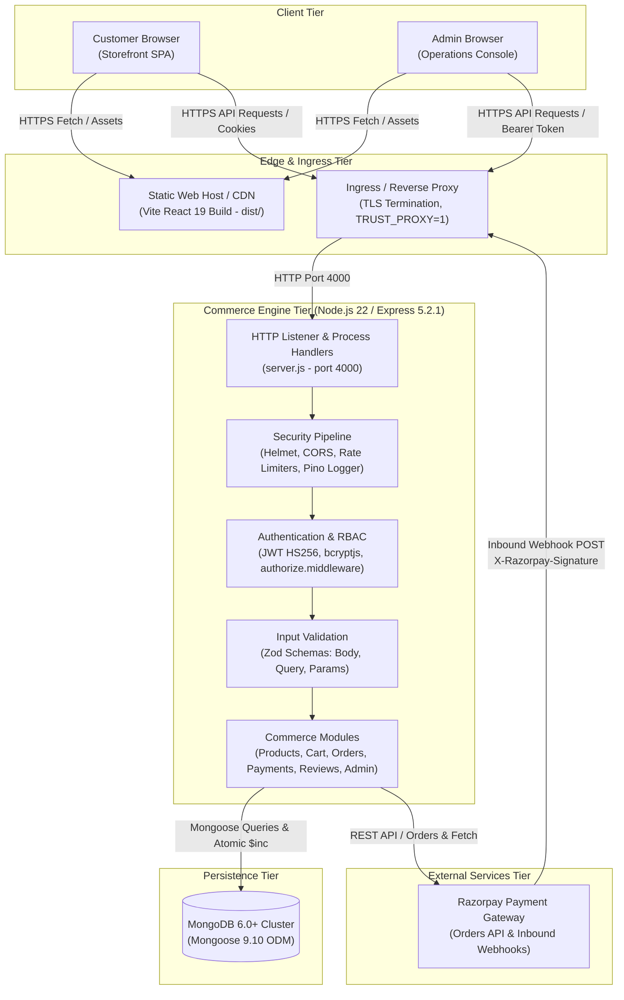
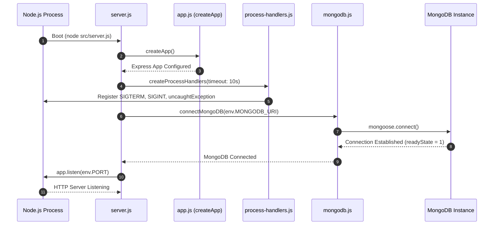
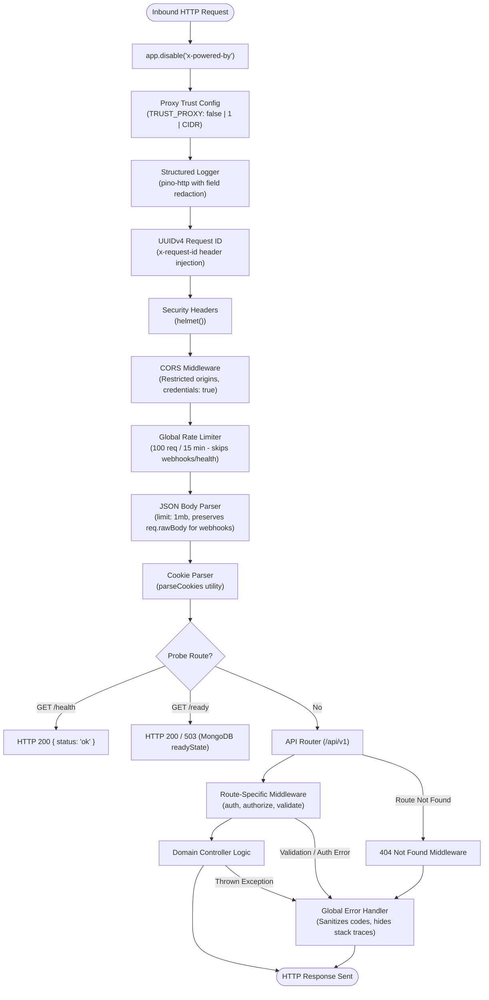
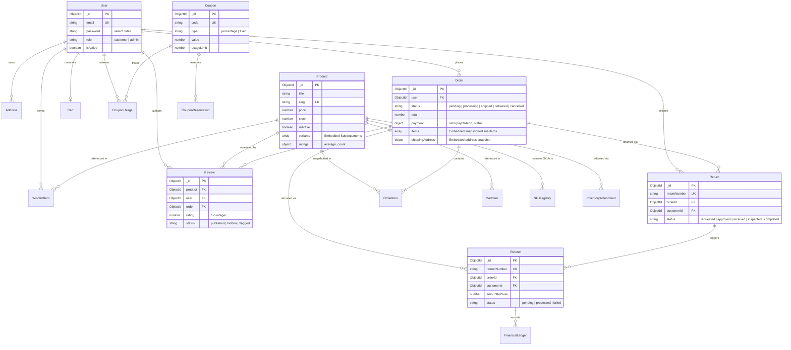
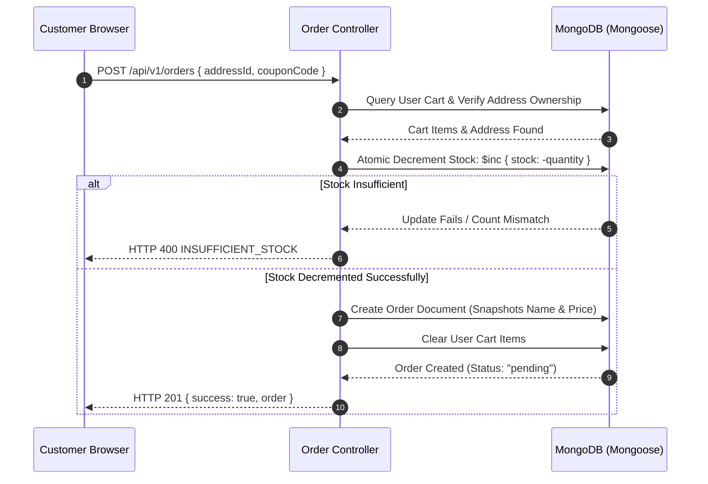
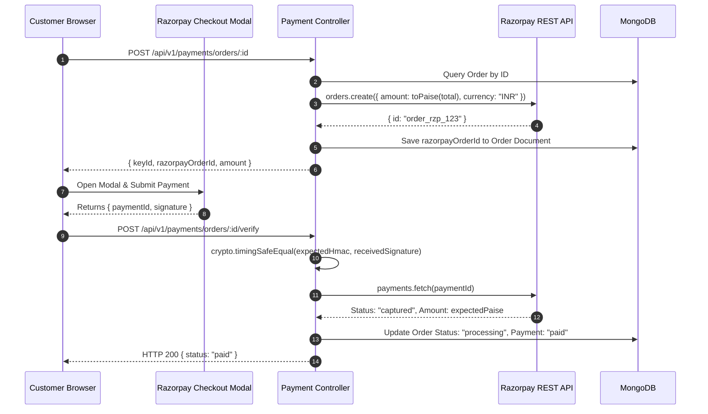

# CommerceFlow — System Architecture Documentation

---

## 1. Document Information

* **Project Name:** CommerceFlow (Monorepo: `commerceflow-api` & `commerceflow-web`)
* **Document Purpose:** Authoritative technical architecture reference for software engineers, code reviewers, security auditors, and system maintainers.
* **Last Updated:** October 14, 2026
* **Scope & Methodology:** Grounded strictly in static source code inspection and verified runtime behavior of the `feature/admin-expansion-staging-prep` branch. Audit claims are verified directly against implementation files.
* **Limitations:** Unwired packages (such as Redis) and client-side browser prototypes (such as localStorage-backed admin wallets/expenses) are explicitly distinguished from active server-side infrastructure.

---

## 2. System Overview

CommerceFlow is an enterprise-oriented, single-merchant direct-to-consumer (D2C) e-commerce platform. It provides a storefront customer experience and an integrated back-office operations console.

### 2.1 Core Architectural Principles
1. **Server-Authoritative Finances:** Line-item prices, taxes, discounts, shipping fees, and grand totals are calculated by backend business logic. Client-submitted prices are discarded.
2. **Atomic Inventory State:** Stock is reserved and adjusted using atomic MongoDB document operations (`$inc`), eliminating overselling without requiring distributed locking.
3. **Cryptographic Payment Integrity:** Gateway order amounts are derived from server totals in paise, verified using timing-safe HMAC SHA-256 comparisons, and processed idempotently via raw webhook payloads.
4. **Dual-Role Authorization:** Strict role-based access control (`customer` vs `admin`) enforced at the API route layer. Single-merchant retail model; no marketplace vendor role is implemented.

### 2.2 Verified System Architecture Diagram



> [!NOTE]
> **Active vs Unwired Infrastructure:** The diagram above reflects only verified runtime components. Although the `redis` npm package is installed and a local daemon may be present, the application layer has zero active connection code to Redis. No message queues (Bull, RabbitMQ) or worker processes exist.

---

## 3. Repository and Workspace Structure

CommerceFlow is structured as an npm-coordinated monorepo under the repository root:

```
./
├── ARCHITECTURE.md                  # System architecture documentation (this document)
├── PRD.md                           # Product Requirements Document
├── STAGING_DEPLOYMENT_CHECKLIST.md  # Runbook and deployment checklists
├── commerceflow-full-system-audit.md # Prior system connection audit log
├── commerceflow-api/                # Backend REST API service
│   ├── Dockerfile                   # Node 22 Alpine unprivileged container definition
│   ├── package.json                 # Backend dependencies and scripts
│   ├── scripts/                     # Administrative maintenance & bootstrap scripts
│   │   ├── create-admin.js          # CLI admin creation tool
│   │   ├── promote-admin.js         # CLI user promotion tool
│   │   ├── safety-helper.js         # Database target safety validator
│   │   └── safety-helper.test.js    # Unit tests for database safety validator
│   └── src/
│       ├── app.js                   # Express application factory & middleware setup
│       ├── server.js                # Process lifecycle, DB connection & HTTP startup
│       ├── common/                  # Shared middleware, process handlers, errors
│       ├── config/                  # Environment variables (Zod) and Pino logger
│       ├── database/                # MongoDB Mongoose connection management
│       ├── infrastructure/          # Infrastructure directories (redis directory empty)
│       ├── modules/                 # Modular domain slices (controllers, routes, models)
│       ├── routes/                  # Central API router aggregator & health probes
│       └── utils/                   # Reusable helpers (pricing, cookie parser)
└── commerceflow-web/                # Frontend React Single Page Application
    ├── package.json                 # Frontend dependencies and scripts
    ├── vite.config.js               # Vite build configuration with Tailwind CSS plugin
    ├── scripts/
    │   └── run-tests.js             # Custom React test runner script
    └── src/
        ├── App.jsx                  # Root client application & custom SPA router
        ├── main.jsx                 # Client entry point (DOM root & StrictMode)
        ├── components/              # Shared UI components (Skeleton, Modal, Badge)
        ├── features/                # Domain-scoped services and React Context providers
        ├── layouts/                 # Storefront MainLayout & AdminLayout
        ├── lib/                     # API client, config, storage, and utility helpers
        ├── pages/                   # Storefront pages (Home, Shop, Cart, Checkout, etc.)
        │   └── admin/               # Admin console pages (Dashboard, Inventory, etc.)
        ├── routes/                  # ProtectedRoute and AdminRoute security wrappers
        └── styles/                  # Tailwind CSS v4 design tokens and utilities
```

---

## 4. Technology Stack

### 4.1 Frontend Platform (`commerceflow-web`)
* **Framework:** React `19.2.8` (Declarative component UI, hooks, Context API)
* **Build Tooling:** Vite `8.3.0` (Native ES Modules dev server, Rollup production bundling)
* **Styling & Design System:** Tailwind CSS `4.3.3` (Tailwind Vite plugin, custom forest-green tokens)
* **Routing:** Custom history-driven SPA router with route-level lazy loading (`React.lazy`, `Suspense`)
* **Testing:** Custom Node.js test runner invoking native React test suites (`733 passing tests across 191 suites`)

### 4.2 Backend Platform (`commerceflow-api`)
* **Runtime:** Node.js `>=20` (Engine 22 LTS, native ECMAScript Modules)
* **Web Framework:** Express `5.2.1`
* **Database ODM:** Mongoose `9.9.5` / `9.10.0` (MongoDB ODM with strict schemas and index definitions)
* **Input Validation:** Zod `4.5.4` (Runtime schema validation for body, query, and params)
* **Cryptography & Auth:** `bcryptjs 3.0.3` (cost factor 12), `jsonwebtoken 9.0.3` (HMAC SHA-256)
* **Security Middleware:** Helmet `8.3.0`, CORS `2.8.6`, express-rate-limit `8.7.0`
* **Logging:** Pino `10.3.1` & pino-http `11.0.0` (ISO timestamps, structured JSON, redaction)
* **Payment Integration:** Razorpay Node SDK `2.9.8`
* **Testing Framework:** Vitest `5.0.0` & Supertest `7.2.2` (`1,810 passing tests across 117 files`)

### 4.3 Runtime Utilization Status
| Technology | Installed Version | Runtime Utilization State | Evidence / Notes |
| :--- | :---: | :---: | :--- |
| **MongoDB** | Database 6.0+ | **ACTIVE RUNTIME** | Mongoose connects in `server.js`; 22 collections queried. |
| **Razorpay SDK** | 2.9.8 | **ACTIVE RUNTIME** | Orders generated in paise; webhooks validated in `app.js`. |
| **Redis** | 6.2.1 | **INSTALLED / UNWIRED** | In `package.json`, but `src/infrastructure/redis` is empty. Zero app calls. |
| **Queue / Workers** | None | **NOT IMPLEMENTED** | All operations (order creation, stock updates) execute synchronously. |

---

## 5. Frontend Architecture

### 5.1 Entry Point and Root Bootstrapping
Execution begins at [`commerceflow-web/src/main.jsx`](./commerceflow-web/src/main.jsx), which mounts [`App.jsx`](./commerceflow-web/src/App.jsx) inside `React.StrictMode` into `#root`.

### 5.2 Routing and Navigation
CommerceFlow employs a custom, lightweight SPA router inside [`App.jsx`](./commerceflow-web/src/App.jsx#L90-L145) based on browser `history.pushState` and `window.addEventListener('popstate')`:
* **Anchor Interception:** Global anchor listener intercepts local relative clicks (`href.startsWith('/')`), calls `pushState`, and updates React state without full page reloads.
* **Code Splitting:** Route components are lazily imported via `React.lazy()` and wrapped in `Suspense` with accessible pulse skeletons ([`RouteLoadingFallback`](./commerceflow-web/src/App.jsx#L68-L88)).
* **Layout Isolation:** Routes are divided into Storefront (`MainLayout`), Admin Console (`AdminLayout`), and Unauthenticated Admin Auth (`AdminLoginPage`, `AdminSetupPage`).

### 5.3 Route Protection Architecture
1. **[`ProtectedRoute.jsx`](./commerceflow-web/src/routes/ProtectedRoute.jsx):** Inspects `useAuth()`. If unauthenticated, preserves target URL in redirect search query (`/login?redirect=...`).
2. **[`AdminRoute.jsx`](./commerceflow-web/src/routes/AdminRoute.jsx):** Checks authentication and strictly verifies `user.role === 'admin'`. Authenticated customers are blocked and presented with an "Access Denied" view. Unauthorized roles (such as `superAdmin`) are rejected. Stale permissions are cleared on logout.

### 5.4 Context and State Management Architecture
To prevent rate-limit exhaustion, state providers are scoped into two tiers:
* **Global Auth Tier:** [`AuthProvider`](./commerceflow-web/src/features/auth/auth.context.jsx) wraps the entire application, maintaining customer/admin session state.
* **Storefront-Scoped Tier:** [`StorefrontProviders`](./commerceflow-web/src/App.jsx#L388-L404) isolates `CartProvider`, `AddressProvider`, `WishlistProvider`, `RecentlyViewedProvider`, `OrderProvider`, and `PaymentProvider`. Administrative pages do not instantiate storefront providers, preventing unneeded customer background fetches.

### 5.5 API Client Architecture ([`apiClient.js`](./commerceflow-web/src/lib/apiClient.js))
* **Base URL Resolution:** Targets `VITE_API_BASE_URL` (defaults to `/api/v1`).
* **Credentials:** Dispatches all requests with `credentials: 'include'` to pass HttpOnly session cookies.
* **Request Deduplication:** Caches in-flight concurrent `GET` requests (`inFlightRequests` Map). Multiple identical components mounting simultaneously share a single network call.
* **Rate-Limit Awareness:** When a `429 Too Many Requests` response is received with a `Retry-After` header, client-side cooldowns are set, blocking subsequent network calls until the cooldown expires.
* **Session Expiry Dispatch:** Receives HTTP 401 with `AUTH_TOKEN_EXPIRED` or `INVALID_AUTH_TOKEN`, purges local tokens, and dispatches a global `commerceflow:session-expired` DOM event.

---

## 6. Backend Architecture

### 6.1 Server Startup Lifecycle ([`server.js`](./commerceflow-api/src/server.js))
1. Instantiates Express app via `createApp()` in [`app.js`](./commerceflow-api/src/app.js).
2. Registers signal and exception handlers via `createProcessHandlers()` ([`process-handlers.js`](./commerceflow-api/src/common/process-handlers.js)).
3. Connects to MongoDB via `connectMongoDB()` ([`mongodb.js`](./commerceflow-api/src/database/mongodb.js)).
4. Starts HTTP listener on `env.PORT` (default: 4000).



### 6.2 Middleware Execution Order
Express executes middleware in strict linear order:



---

## 7. API Organization

All application API endpoints are grouped under `/api/v1` via [`commerceflow-api/src/routes/index.js`](./commerceflow-api/src/routes/index.js).

| Route Prefix | Sub-Router Path | Primary Responsibility | Authentication Requirements |
| :--- | :--- | :--- | :--- |
| `/health` | `routes/health.routes.js` | System liveness (`/live`) and DB dependency readiness (`/ready`). | Public (Bypasses rate limiting) |
| `/users` | `modules/users/user.routes.js` | Registration, login, profile (`/me`), and addresses. | Mixed: Auth endpoints public; profile/address Bearer required |
| `/products` | `modules/products/product.routes.js` | Catalog search, categories, product details, customer reviews. | Public (Review submission requires Bearer) |
| `/cart` | `modules/cart/cart.routes.js` | Item add/update/delete, cart merge, coupon application. | Bearer required (`authMiddleware`) |
| `/wishlist`| `modules/wishlist/wishlist.routes.js` | Wishlist toggling, listing, and clearing. | Bearer required (`authMiddleware`) |
| `/orders` | `modules/orders/order.routes.js` | Checkout creation, customer order history, self-service cancellation. | Bearer required (`authMiddleware`) |
| `/payments`| `modules/payments/payment.routes.js` | Gateway order generation, HMAC verification, inbound webhooks. | Mixed: Order/Verify requires Bearer; Webhook verified by HMAC |
| `/banners` | `modules/banners/banner.routes.js` | Storefront banner delivery (hero, top-bar, category). | Public |
| `/admin` | `routes/admin.routes.js` | Control panel modules (catalog, orders, inventory, audit logs). | **Admin required** (`authMiddleware` + `authorize('admin')`) |

---

## 8. Authentication and Authorization

### 8.1 Authentication Token Architecture
* **Algorithm:** HMAC SHA-256 (`HS256`) via `jsonwebtoken`.
* **Payload:** Contains `id: user._id` and `role: user.role`.
* **Expiration:** Configured via `env.JWT_EXPIRES_IN` (default: `20m`).
* **Transport:** Client passes token via `Authorization: Bearer <token>` or via HttpOnly cookie.

### 8.2 Authorization Pipeline
1. **[`auth.middleware.js`](./commerceflow-api/src/common/middleware/auth.middleware.js):**
   * Extracts Bearer token from `Authorization` header (or fallback `req.cookies.token`).
   * Validates signature against `env.JWT_SECRET`. Rejects expired tokens with HTTP 401 `AUTH_TOKEN_EXPIRED`.
   * Queries `User.findById(decoded.id)`. If user is deleted or inactive (`isActive: false`), returns HTTP 401.
   * Attaches sanitized Mongoose user document to `req.user`.
2. **[`authorize.middleware.js`](./commerceflow-api/src/common/middleware/authorize.middleware.js):**
   * Accepts list of allowed roles (e.g. `authorize("admin")`).
   * Compares `req.user.role`. If unapproved, immediately returns HTTP 403 `FORBIDDEN_RESOURCE`.
   * Prevents customer role escalation.

---

## 9. Data Architecture

### 9.1 Database Technology
* **Engine:** MongoDB 6.0+
* **Interface:** Mongoose 9.10 ODM
* **Connection Lifecycle:** Dedicated singleton in [`mongodb.js`](./commerceflow-api/src/database/mongodb.js). Tracks connection states (`disconnected`, `connected`, `connecting`, `disconnecting`).

### 9.2 Verified Entity Relationship Diagram (ERD)



### 9.3 Data Integrity & Consistency Rules
* **Price Snapshotting:** Orders store line-item prices at checkout time. Future product catalog updates never alter existing order costs.
* **Atomic Stock Mutation:** Stock is incremented or decremented using MongoDB atomic operators (`$inc`). Race conditions are avoided at the document level without multi-document locking.
* **Catalog-Wide SKU Uniqueness:** Handled by a dedicated [`SkuRegistry`](./commerceflow-api/src/modules/products/sku-registry.model.js) collection and service to prevent embedded multikey index collisions.
* **Rating Recalculation Rollback:** When reviews are moderated or deleted, product rating averages are updated automatically. If the recomputation fails, review status changes are rolled back.

---

## 10. Payment and External Integrations

### 10.1 Razorpay Architecture
* **Initialization:** Instantiated in [`razorpay.service.js`](./commerceflow-api/src/modules/payments/razorpay.service.js) with `RAZORPAY_KEY_ID` and `RAZORPAY_KEY_SECRET`.
* **Paise Currency Conversion:** Inbound order amounts are converted to integer paise (`Math.round(order.total * 100)`).
* **Checkout Order Creation (`POST /payments/orders/:orderId`):** Generates gateway order ID and stores it in `order.payment.razorpayOrderId`. Idempotent: reuses existing active gateway order IDs.
* **Signature Verification (`POST /payments/orders/:orderId/verify`):** Generates expected HMAC SHA-256 signature and validates it using `crypto.timingSafeEqual`. Confirms currency is `INR` and amount matches expected paise before marking order `paid`.

### 10.2 Webhook Processing (`POST /payments/webhook`)
* **Raw Body Preservation:** Express JSON parser in [`app.js`](./commerceflow-api/src/app.js#L143-L148) intercepts `/api/v1/payments/webhook` requests and saves the raw payload buffer to `req.rawBody`.
* **Signature Validation:** Compares `x-razorpay-signature` against HMAC of `req.rawBody` using `RAZORPAY_WEBHOOK_SECRET`.
* **Idempotency Guarantee:** Stores event ID in `WebhookEvent` with a unique index. Duplicate webhook retries from Razorpay exit with HTTP 200 without duplicate processing.

---

## 11. Admin Architecture

CommerceFlow features an administrative operations console with navigation organized into 8 functional sections in [`adminNavConfig.js`](./commerceflow-web/src/layouts/admin/adminNavConfig.js):

| Section | Backed by Server-Side Persistence | Preview / LocalStorage Demo | Informational / Governance |
| :--- | :--- | :--- | :--- |
| **1. Dashboard** | `/api/v1/admin/dashboard` (Real MongoDB aggregation) | None | None |
| **2. Catalog & Inventory** | Products, Categories, Brands, Variants, Inventory Adjustments | None | None |
| **3. Sales & Customers** | Orders, Returns (RMA), Refunds, Reviews, Customers | None | None |
| **4. Marketing** | Coupons (`/admin/coupons`), Banners (`/admin/banners`) | Campaigns (`localStorage`: `commerceflow_admin_campaigns_v1`) | None |
| **5. Wallet & Finance** | Refunds & Ledger (`/admin/refunds`) | Customer Wallets & Expenses (`localStorage`: `commerceflow_admin_wallets_v1`) | None |
| **6. People & Achievements**| Staff directory (`/admin/users`), Staff Performance Audit aggregates | Staff Achievements (In-memory static catalog) | Roles & Permissions Matrix |
| **7. Reports & Analytics** | Sales Reports (CSV export with CWE-1236 protection) | None | None |
| **8. System & Security** | Audit Logs (`/admin/audit-logs`), Store Settings (`/admin/settings`) | None | Vendors Directory (Single-merchant notice) |

---

## 12. Security Architecture

### 12.1 Verified Security Controls

| Security Control | Implementation File | Verified Mechanism |
| :--- | :--- | :--- |
| **Password Hashing** | [`user.model.js`](./commerceflow-api/src/modules/users/user.model.js) | bcrypt cost factor 12 before persistence. |
| **Token Authentication** | [`auth.middleware.js`](./commerceflow-api/src/common/middleware/auth.middleware.js) | Validates HMAC SHA-256 JWT signature and user account status. |
| **Role-Based Authorization** | [`authorize.middleware.js`](./commerceflow-api/src/common/middleware/authorize.middleware.js) | Checks `req.user.role === 'admin'`. Rejects unauthorized roles. |
| **Timing-Safe Cryptography** | [`verify-payment.controller.js`](./commerceflow-api/src/modules/payments/verify-payment.controller.js) | `crypto.timingSafeEqual` prevents side-channel timing leaks. |
| **Webhook Signature Check** | [`app.js`](./commerceflow-api/src/app.js) & [`webhook.controller.js`](./commerceflow-api/src/modules/payments/webhook.controller.js) | Validates HMAC against untouched raw buffer `req.rawBody`. |
| **Structured Log Redaction** | [`logger.js`](./commerceflow-api/src/config/logger.js) | Pino redacts `password`, `token`, `cookie`, `razorpaySignature`. |
| **Rate Limiting** | [`app.js`](./commerceflow-api/src/app.js) & [`auth-rate-limit.middleware.js`](./commerceflow-api/src/common/middleware/auth-rate-limit.middleware.js) | Global: 100/15m; Auth: 10/15m; Webhook: 60/15m. |
| **Formula Injection (CWE-1236)**| [`AdminReportsPage.jsx`](./commerceflow-web/src/pages/admin/AdminReportsPage.jsx) | `sanitizeCsvCell()` prepends single quote to `=`, `+`, `-`, `@`. |
| **Banner URL Sanitization** | [`banner.model.js`](./commerceflow-api/src/modules/banners/banner.model.js) | `isValidBannerTargetUrl()` blocks `javascript:`, `data:`, control chars. |
| **Database Target Guard** | [`safety-helper.js`](./commerceflow-api/scripts/safety-helper.js) | Unconditionally blocks `NODE_ENV=production` in CLI bootstrap tools. |

---

## 13. Testing Architecture

### 13.1 Backend Test Architecture (`commerceflow-api`)
* **Tooling:** Vitest `5.0.0` with Supertest `7.2.2`.
* **Verified Execution Baseline:** **1,810 tests passing across 117 test files** (1 file / 18 tests skipped).
* **Execution Command:** `npx vitest run` (or `npm test` from `commerceflow-api`).
* **Test Isolation:** Supertest initializes ephemeral Express instances via `createApp()` with in-memory or isolated database targets.

### 13.2 Frontend Test Architecture (`commerceflow-web`)
* **Tooling:** Custom test harness in [`scripts/run-tests.js`](./commerceflow-web/scripts/run-tests.js).
* **Verified Execution Baseline:** **733 tests passing across 191 test suites** (0 failures).
* **Execution Command:** `node scripts/run-tests.js` (or `npm test` from `commerceflow-web`).
* **Test Isolation:** Renders React components in JSDOM, asserting route guards, UI state machines, and cart/wishlist storage.

---

## 14. Deployment and Runtime Architecture

### 14.1 Container Definition (`commerceflow-api/Dockerfile`)
* **Base Image:** `node:22-alpine`
* **Dependency Strategy:** Multi-stage caching; runs `npm ci --omit=dev`.
* **Security Hardening:** Drops root privileges; executes as `USER node` (UID 1000).
* **Port:** Exposes internal HTTP port `4000`.
* **Container Healthcheck:** Queries `http://127.0.0.1:4000/api/v1/health/live` every 30s.

### 14.2 Environment Configuration Architecture
Configuration is validated at startup by Zod in [`env.js`](./commerceflow-api/src/config/env.js). Application crashes immediately if required variables are missing or malformed:

| Environment Variable | Classification | Description |
| :--- | :---: | :--- |
| `NODE_ENV` | Public | Environment mode (`development`, `test`, `staging`, `production`). |
| `PORT` | Public | HTTP port (default: 4000). |
| `MONGODB_URI` | **Secret** | Connection string pointing to isolated MongoDB cluster. |
| `JWT_SECRET` | **Secret** | Cryptographic token signing secret (min length: 32). |
| `RAZORPAY_KEY_ID` | Public | Gateway Key ID (Test key starts with `rzp_test_`). |
| `RAZORPAY_KEY_SECRET` | **Secret** | Gateway Secret for order creation and verification. |
| `RAZORPAY_WEBHOOK_SECRET` | **Secret** | Gateway Webhook secret for HMAC signature verification. |
| `CORS_ORIGIN` | Public | Allowed frontend origin. Wildcards forbidden in production. |
| `TRUST_PROXY` | Public | Reverse proxy hop count (`1`) or trusted CIDR. |

---

## 15. Important Runtime Flows

### 15.1 Customer Checkout & Atomic Stock Deduction



### 15.2 Gateway Payment Verification



---

## 16. Architectural Risks and Limitations

### 16.1 Confirmed Risks
1. **In-Memory Rate Limiting Across Instances:** `express-rate-limit` currently uses memory stores. When deployed across multiple horizontal container instances, rate limits will be per-instance rather than global.
   * *Impact:* Rate-limit thresholds multiply by the number of running instances.
   * *Status:* Confirmed architectural limitation.
2. **Synchronous Notification Processing:** Order placement, stock adjustments, and refund operations execute synchronously within the HTTP request thread.
   * *Impact:* When external email/SMS notifications are added, HTTP latency could increase without a background queue.
   * *Status:* Confirmed architectural limitation.
3. **Client-Side Administrative Persistence:** The Wallets (`/admin/wallets`), Expenses (`/admin/finance/expenses`), and Campaigns (`/admin/campaigns`) screens store data in browser `localStorage`.
   * *Impact:* Data entered on these screens does not persist to MongoDB or sync across different administrative browsers.
   * *Status:* Confirmed gap.

---

## 17. Architecture Decisions and Recommendations

### 17.1 Architecture Decisions (Evidenced in Codebase)
* **ADR-001 (Server-Authoritative Pricing):** Client submissions of unit prices, discounts, or order totals are discarded. All pricing is computed server-side to guarantee financial integrity.
* **ADR-002 (Hybrid Embedded Variants & Global SKU Registry):** Product variants are embedded in `Product` documents for fast single-query retrieval, while global SKU uniqueness is enforced via a separate `SkuRegistry` collection to avoid MongoDB multikey sparse index issues.
* **ADR-003 (Dual-Role RBAC Model):** Single-merchant retail model with exactly two roles (`customer` and `admin`). Multi-vendor marketplace complexity is excluded from the core architecture.
* **ADR-004 (Raw Buffer Webhook Verification):** Express preserves the raw request body buffer (`req.rawBody`) for the webhook route, preventing JSON re-serialization differences from corrupting cryptographic signatures.

### 17.2 Architectural Recommendations (Future Phases)
* **REC-001 (Connect Installed Redis):** Implement a client in `src/infrastructure/redis/` to back `express-rate-limit` and cache public catalog queries.
* **REC-002 (Introduce BullMQ Background Queue):** Add Redis-backed queues for asynchronous transactional email notifications and PDF receipt generation.
* **REC-003 (Server Persistence for Wallets & Expenses):** Migrate client-side `localStorage` data for customer wallets and business expenses to dedicated Mongoose collections.

---

## 18. Glossary and References

### 18.1 Glossary
* **D2C (Direct-to-Consumer):** Single-merchant retail model where the store owner sells directly to consumers without third-party marketplace vendors.
* **Idempotency:** An operation that produces the exact same result whether executed once or multiple times (e.g. payment webhook processing).
* **Paise:** The fractional unit of Indian currency (1 INR = 100 paise). Razorpay requires all payment amounts to be specified in paise integers.
* **RMA (Return Merchandise Authorization):** Formal order return lifecycle tracking items from request to inspection and restocking.
* **Timing Attack:** A side-channel attack where an adversary infers secret cryptographic signatures by measuring subtle execution time differences. Mitigated via `crypto.timingSafeEqual`.

### 18.2 Document References
* [Product Requirements Document (PRD)](./PRD.md)
* [Staging Deployment Checklist](./STAGING_DEPLOYMENT_CHECKLIST.md)
* [Full System Connection Audit](./commerceflow-full-system-audit.md)
* [Backend Server Entry Point](./commerceflow-api/src/server.js)
* [Frontend Client Entry Point](./commerceflow-web/src/App.jsx)

---

*End of CommerceFlow System Architecture Documentation*
