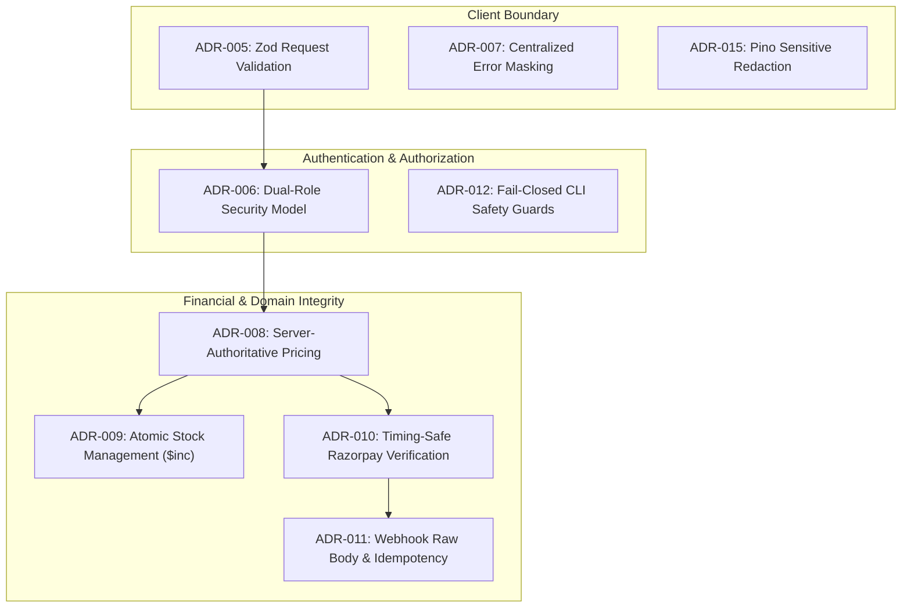

# CommerceFlow Architecture Decision Log (DECISIONS.md)

> **Document Status**: Authoritative Architecture Decision Log
> **Repository Root**: repository root
> **Last-Reviewed Date**: October 14, 2026
> **Active Baseline Branch**: `feature/admin-expansion-staging-prep` (Target: `main`)
> **Related Architecture Documentation**: [`PRD.md`](./PRD.md), [`ARCHITECTURE.md`](./ARCHITECTURE.md), [`DESIGN.md`](./DESIGN.md), [`RULES.md`](./RULES.md), [`TASKS.md`](./TASKS.md)

---

## 1. Document Purpose and Conventions

### 1.1 Purpose
This Architecture Decision Log (ADL) records significant technical, architectural, security, product, and operational decisions governing the CommerceFlow platform. It provides contributors, reviewers, and AI coding agents with verifiable rationale for why the codebase is structured as it is, preventing redundant re-evaluations and unintentional architectural regressions.

### 1.2 Decision Classification Taxonomy
To prevent the fabrication of historical intent, every entry in this document is strictly classified under one of five categories based on verified repository evidence:

| Status | Definition |
| :--- | :--- |
| **`Accepted`** | A deliberate decision explicitly established, documented, and enforced by authoritative project documentation (`PRD.md`, `ARCHITECTURE.md`, `RULES.md`) or verified audit reports. |
| **`Implemented constraint`** | An observable technical constraint or structural implementation choice present in the codebase, without documentary evidence that an explicit architectural evaluation was recorded. |
| **`Proposed`** | A technical recommendation awaiting review and formal approval by the project owner; not yet approved or implemented. |
| **`Superseded`** | A previously accepted or implemented pattern that has been deliberately replaced by a subsequent architectural decision. |
| **`Deprecated`** | A legacy pattern or component scheduled for removal or replacement, retained temporarily for backward compatibility. |

### 1.3 Modifying and Adding ADRs
1. **Immutable Historical Records**: Accepted decisions must not be edited retroactively to match code changes. When a decision changes, create a new ADR, mark the previous ADR as `Superseded`, and cross-link both entries.
2. **Evidence-First Rule**: Every new entry must cite real repository file paths, tests, or configuration files. If the original rationale is unknown, explicitly record **"Rationale not documented"**.
3. **No Automatic Authorization**: Proposing or recording an ADR does not authorize making changes to application source code or staging environments.

---

## 2. Decision Index

| ID | Title | Status | Area | Date | Evidence |
| :--- | :--- | :---: | :--- | :---: | :--- |
| **[ADR-001](#adr-001-decoupled-monorepo-structure-without-root-workspaces)** | Decoupled Monorepo Structure Without Root Workspaces | **Implemented constraint** | Technology / Repository | Date not documented | Root directory lacks `package.json`; decoupled subprojects |
| **[ADR-002](#adr-002-pure-native-es-modules-esm-for-backend-api)** | Pure Native ES Modules (ESM) for Backend API | **Accepted** | Backend Architecture | Date not documented | [`commerceflow-api/package.json`](./commerceflow-api/package.json) (`"type": "module"`) |
| **[ADR-003](#adr-003-react-19-vite-8-and-tailwind-css-v4-frontend-stack)** | React 19, Vite 8, and Tailwind CSS v4 Frontend Stack | **Implemented constraint** | Frontend Architecture | Date not documented | [`commerceflow-web/package.json`](./commerceflow-web/package.json) |
| **[ADR-004](#adr-004-layered-separation-of-routes-validators-controllers-services-and-models)** | Layered Separation of Routes, Validators, Controllers, Services, and Models | **Accepted** | Backend Architecture | October 2026 | [`RULES.md`](./RULES.md), `commerceflow-api/src/` directory hierarchy |
| **[ADR-005](#adr-005-declarative-request-validation-via-zod-schemas-at-trust-boundaries)** | Declarative Request Validation via Zod Schemas at Trust Boundaries | **Accepted** | Security / Backend | September 2026 | [`validate.middleware.js`](./commerceflow-api/src/common/middleware/validate.middleware.js), `*.validator.js` |
| **[ADR-006](#adr-006-strict-dual-role-security-model-customer-and-admin)** | Strict Dual-Role Security Model (`customer` and `admin`) | **Accepted** | Security / Domain | September 2026 | [`user.model.js`](./commerceflow-api/src/modules/users/user.model.js), [`auth.middleware.js`](./commerceflow-api/src/common/middleware/auth.middleware.js) |
| **[ADR-007](#adr-007-centralized-error-envelope-and-production-detail-masking)** | Centralized Error Envelope and Production Detail Masking | **Accepted** | Backend Architecture | September 2026 | [`error.middleware.js`](./commerceflow-api/src/common/middleware/error.middleware.js) |
| **[ADR-008](#adr-008-server-authoritative-pricing-and-order-snapshotting)** | Server-Authoritative Pricing and Order Snapshotting | **Accepted** | Commerce Domain | September 2026 | [`order.controller.js`](./commerceflow-api/src/modules/orders/order.controller.js), [`order.model.js`](./commerceflow-api/src/modules/orders/order.model.js) |
| **[ADR-009](#adr-009-atomic-inventory-deductions-and-restorations-via-mongodb-inc)** | Atomic Inventory Deductions and Restorations via MongoDB `$inc` | **Accepted** | Data Integrity | September 2026 | [`order.controller.js`](./commerceflow-api/src/modules/orders/order.controller.js) |
| **[ADR-010](#adr-010-razorpay-server-calculated-paise-and-timing-safe-hmac-verification)** | Razorpay Server-Calculated Paise and Timing-Safe HMAC Verification | **Accepted** | Payments / Security | September 2026 | [`razorpay.service.js`](./commerceflow-api/src/modules/payments/razorpay.service.js) |
| **[ADR-011](#adr-011-payment-webhook-raw-body-preservation-and-idempotency-tracking)** | Payment Webhook Raw Body Preservation and Idempotency Tracking | **Accepted** | Payments / Webhooks | September 2026 | [`src/app.js`](./commerceflow-api/src/app.js), [`webhook-event.model.js`](./commerceflow-api/src/modules/payments/webhook-event.model.js) |
| **[ADR-012](#adr-012-fail-closed-interactive-guards-for-cli-database-mutation-scripts)** | Fail-Closed Interactive Guards for CLI Database Mutation Scripts | **Accepted** | Operational Safety | October 2026 | [`scripts/safety-helper.js`](./commerceflow-api/scripts/safety-helper.js), [`safety-helper.test.js`](./commerceflow-api/scripts/safety-helper.test.js) |
| **[ADR-013](#adr-013-standalone-mongodb-compatibility-without-multi-document-transactions)** | Standalone MongoDB Compatibility Without Multi-Document Transactions | **Implemented constraint** | Database / Infra | October 2026 | Standalone local dev vs. replica set CI; no `startSession()` in app code |
| **[ADR-014](#adr-014-containerization-baseline-using-unprivileged-user-on-alpine)** | Containerization Baseline Using Unprivileged User on Alpine | **Accepted** | Infrastructure | September 2026 | [`commerceflow-api/Dockerfile`](./commerceflow-api/Dockerfile) (`USER node`, Node 22 Alpine) |
| **[ADR-015](#adr-015-structured-pino-logging-with-mandatory-sensitive-field-redaction)** | Structured Pino Logging with Mandatory Sensitive Field Redaction | **Accepted** | Observability / Security | September 2026 | [`src/common/logger.js`](./commerceflow-api/src/config/logger.js) |
| **[ADR-016](#adr-016-client-side-storage-prototypes-for-admin-finance-and-campaigns)** | Client-Side Storage Prototypes for Admin Finance and Campaigns | **Implemented constraint** | Frontend / Admin | October 2026 | `AdminFinancePage.jsx` (`localStorage`), `AdminCampaignsPage.jsx` |

---

## 3. Architecture Decision Records (ADRs)

### ADR-001: Decoupled Monorepo Structure Without Root Workspaces

- **Status:** Implemented constraint
- **Date:** Date not documented
- **Area:** Technology / Repository Structure
- **Context:** The repository contains both the backend API and frontend SPA within a single Git repository (repository root), but lacks a root-level `package.json` or npm workspaces configuration.
- **Decision:** Maintain two completely independent Node.js packages: `commerceflow-api` and `commerceflow-web`, each with its own `package.json`, lockfile, dependencies, and test runner.
- **Rationale:** Rationale not documented. Preserves complete isolation between backend and frontend build environments.
- **Alternatives:** Not documented. (See [PROP-001](#prop-001-introduce-root-packagejson-with-npm-workspaces) for proposed workspace consolidation).
- **Consequences:**
  - Scripts must be executed from within each subproject directory (`cd commerceflow-api && npm test`).
  - No shared code or cross-package symlinks exist between frontend and backend.
  - Dependencies must be updated and audited separately in both directories.
- **Evidence:** Root directory listing of repository root shows only subdirectories and documentation; `package.json` exists only in subprojects.
- **Related decisions:** None.

---

### ADR-002: Pure Native ES Modules (ESM) for Backend API

- **Status:** Accepted
- **Date:** Date not documented
- **Area:** Backend Architecture
- **Context:** Node.js applications traditionally used CommonJS (`require`/`module.exports`), but modern JavaScript standards favor ECMAScript Modules (`import`/`export`).
- **Decision:** Configure `commerceflow-api/package.json` with `"type": "module"`. All backend source code, routes, controllers, and tests must use native ESM imports.
- **Rationale:** Aligns with standard ECMAScript specifications, matches frontend module syntax, and enables top-level await and native Vitest compatibility.
- **Alternatives:** CommonJS format.
- **Consequences:**
  - CommonJS globals (`__dirname`, `__filename`, `require`) are unavailable without `import.meta.url` helpers.
  - All local file imports must explicitly specify the `.js` extension (e.g., `import auth from './auth.js'`).
- **Evidence:** [`commerceflow-api/package.json`](./commerceflow-api/package.json) line 10 (`"type": "module"`).
- **Related decisions:** [ADR-004](#adr-004-layered-separation-of-routes-validators-controllers-services-and-models).

---

### ADR-003: React 19, Vite 8, and Tailwind CSS v4 Frontend Stack

- **Status:** Implemented constraint
- **Date:** Date not documented
- **Area:** Frontend Architecture
- **Context:** The web application requires a modern, responsive single-page architecture with fast local development compilation and utility-first styling.
- **Decision:** Build `commerceflow-web` using React 19 (`^19.2.8`), Vite 8 (`^8.3.0`), and Tailwind CSS v4 (`^4.3.3`) via `@tailwindcss/vite`.
- **Rationale:** Rationale not documented. Delivers sub-second local HMR and fast production bundle compilation (408ms in benchmark audits).
- **Alternatives:** Not documented.
- **Consequences:**
  - Requires React 19-compatible component patterns and test environments.
  - Uses Tailwind CSS v4 CSS-first configuration (`@theme` tokens in CSS) rather than legacy `tailwind.config.js`.
- **Evidence:** [`commerceflow-web/package.json`](./commerceflow-web/package.json) dependencies and devDependencies.
- **Related decisions:** None.

---

### ADR-004: Layered Separation of Routes, Validators, Controllers, Services, and Models

- **Status:** Accepted
- **Date:** October 2026
- **Area:** Backend Architecture
- **Context:** Backend maintainability requires avoiding bloated controllers or mixing database queries with HTTP routing logic.
- **Decision:** Enforce a strict 5-layer separation of concerns across `commerceflow-api`:
  1. **Routes**: Define endpoints, verbs, and wire middleware pipelines.
  2. **Validators**: Declare Zod validation schemas for `body`, `query`, and `params`.
  3. **Controllers**: Parse request input, delegate to services, and send HTTP responses.
  4. **Services**: Contain domain business logic, computations, and third-party orchestration.
  5. **Models**: Mongoose schemas, indexes, hooks, and virtuals.
- **Rationale:** Decouples domain logic from the Express framework, simplifies unit testing without mocking HTTP requests, and ensures consistent error boundaries.
- **Alternatives:** Anemic MVC (fat controllers querying Mongoose directly).
- **Consequences:** Every new endpoint requires updates across multiple modular files rather than a single controller script.
- **Evidence:** Documented in [`RULES.md`](./RULES.md) Section 6.1; implemented throughout `commerceflow-api/src/modules/`.
- **Related decisions:** [ADR-005](#adr-005-declarative-request-validation-via-zod-schemas-at-trust-boundaries), [ADR-007](#adr-007-centralized-error-envelope-and-production-detail-masking).

---

### ADR-005: Declarative Request Validation via Zod Schemas at Trust Boundaries

- **Status:** Accepted
- **Date:** September 2026
- **Area:** Security / Backend Architecture
- **Context:** Client requests cannot be trusted. Unvalidated input can cause runtime crashes, NoSQL injection, and data corruption.
- **Decision:** Enforce input validation at the Express routing layer using declarative **Zod** (`^4.5.4`) schemas attached via [`validate.middleware.js`](./commerceflow-api/src/common/middleware/validate.middleware.js).
- **Rationale:** Guarantees type safety and validates business constraints (e.g., minimum string lengths, email formats, positive quantities) before controller execution.
- **Alternatives:** Manual in-controller `if` checks or Joi/Celebrate.
- **Consequences:** Requests failing schema validation are automatically rejected with HTTP 400 `VALIDATION_ERROR` before reaching domain services.
- **Evidence:** [`commerceflow-api/src/common/middleware/validate.middleware.js`](./commerceflow-api/src/common/middleware/validate.middleware.js); validators in `src/modules/*/*.validator.js`.
- **Related decisions:** [ADR-004](#adr-004-layered-separation-of-routes-validators-controllers-services-and-models).

---

### ADR-006: Strict Dual-Role Security Model (`customer` and `admin`)

- **Status:** Accepted
- **Date:** September 2026
- **Area:** Security / Product Domain
- **Context:** The platform requires administrative back-office capabilities while serving customer storefront users.
- **Decision:** Implement a strict, two-tier role model in [`user.model.js`](./commerceflow-api/src/modules/users/user.model.js): `'customer'` (default) and `'admin'`. There are no intermediate roles (e.g., `'vendor'`, `'manager'`, `'superAdmin'`).
- **Rationale:** Simplifies authorization logic for a single-merchant direct-to-consumer (D2C) store, eliminating complex role-permission matrix overhead.
- **Alternatives:** Multi-role hierarchical RBAC or permissions-based ACL.
- **Consequences:**
  - Administrative routes are protected unconditionally by `authorize('admin')`.
  - Frontend admin views that simulate granular roles (`AdminRolesPage.jsx`) are cosmetic prototypes without backend permission enforcement.
- **Evidence:** [`commerceflow-api/src/models/user.model.js`](./commerceflow-api/src/modules/users/user.model.js); [`authorize.middleware.js`](./commerceflow-api/src/common/middleware/authorize.middleware.js).
- **Related decisions:** [ADR-012](#adr-012-fail-closed-interactive-guards-for-cli-database-mutation-scripts), [OPEN-003](#open-003-granularity-of-administrative-role-and-permissions-model).

---

### ADR-007: Centralized Error Envelope and Production Detail Masking

- **Status:** Accepted
- **Date:** September 2026
- **Area:** Backend Architecture / Security
- **Context:** Exposing internal error messages, MongoDB connection strings, or stack traces leaks security details to clients.
- **Decision:** Route all backend operational and system errors through a centralized error handler ([`error.middleware.js`](./commerceflow-api/src/common/middleware/error.middleware.js)) returning a uniform JSON envelope: `{ success: false, error: { code, message, details }, requestId }`. In production (`NODE_ENV === 'production'`), internal database exceptions and stack traces are suppressed.
- **Rationale:** Prevents sensitive data leakage, maps Mongoose duplicate key codes (11000) and CastErrors to user-safe HTTP status codes (409 and 400), and correlates errors via unique `requestId`.
- **Alternatives:** Inline try-catch blocks with custom ad-hoc error responses.
- **Consequences:** Controllers must forward errors via Express `next(error)` rather than formatting disparate error responses.
- **Evidence:** [`commerceflow-api/src/common/middleware/error.middleware.js`](./commerceflow-api/src/common/middleware/error.middleware.js); verified in September 30 audit.
- **Related decisions:** [ADR-015](#adr-015-structured-pino-logging-with-mandatory-sensitive-field-redaction).

---

### ADR-008: Server-Authoritative Pricing and Order Snapshotting

- **Status:** Accepted
- **Date:** September 2026
- **Area:** Commerce Domain / Financial Security
- **Context:** Clients can manipulate HTTP payloads to tamper with product prices, discounts, or order totals.
- **Decision:** Order totals MUST be computed entirely server-side from active database records. Order items snapshot the product name and unit price at checkout time:
  ```javascript
  // Server-authoritative calculation in order.service.js
  const itemTotal = product.price * item.quantity;
  ```
- **Rationale:** Eliminates price tampering vulnerabilities and guarantees historical order financial consistency even if product catalog prices change retroactively.
- **Alternatives:** Trusting client-supplied line-item totals or cart totals.
- **Consequences:** Any client-supplied price or total parameter in `POST /api/v1/orders` is ignored.
- **Evidence:** [`commerceflow-api/src/modules/orders/order.controller.js`](./commerceflow-api/src/modules/orders/order.controller.js); audit verification lines 228–234.
- **Related decisions:** [ADR-009](#adr-009-atomic-inventory-deductions-and-restorations-via-mongodb-inc), [ADR-010](#adr-010-razorpay-server-calculated-paise-and-timing-safe-hmac-verification).

---

### ADR-009: Atomic Inventory Deductions and Restorations via MongoDB `$inc`

- **Status:** Accepted
- **Date:** September 2026
- **Area:** Data Integrity / Concurrency
- **Context:** Concurrent purchases of the same product can cause race conditions leading to overselling beyond available inventory.
- **Decision:** Decrement product stock using atomic MongoDB query operators with conditional stock checks:
  ```javascript
  const product = await Product.findOneAndUpdate(
    { _id: item.product, stock: { $gte: item.quantity }, isActive: true },
    { $inc: { stock: -item.quantity } },
    { new: true }
  );
  if (!product) throw new ApiError(400, 'INSUFFICIENT_STOCK');
  ```
  Stock is similarly restored using atomic `$inc: { stock: item.quantity }` on order cancellation.
- **Rationale:** Protects inventory levels without requiring heavy multi-document distributed locking or replica set transactions.
- **Alternatives:** Read-modify-write application loops with optimistic concurrency version keys.
- **Consequences:** Stock reservation is safe under concurrency, but requires compensating rollback loops if subsequent order items fail availability checks.
- **Evidence:** [`commerceflow-api/src/modules/orders/order.controller.js`](./commerceflow-api/src/modules/orders/order.controller.js) & [`order-cancellation.service.js`](./commerceflow-api/src/modules/orders/order-cancellation.service.js); audit failure scenarios section 31.
- **Related decisions:** [ADR-008](#adr-008-server-authoritative-pricing-and-order-snapshotting), [ADR-013](#adr-013-standalone-mongodb-compatibility-without-multi-document-transactions).

---

### ADR-010: Razorpay Server-Calculated Paise and Timing-Safe HMAC Verification

- **Status:** Accepted
- **Date:** September 2026
- **Area:** Payments / Security
- **Context:** Razorpay gateway operates in Indian paise (1 INR = 100 paise). Floating-point conversions can cause rounding discrepancies, and insecure signature comparisons are vulnerable to timing attacks.
- **Decision:**
  1. Convert order totals to paise on the server using `toPaise(total)` (`Math.round(total * 100)`).
  2. Verify Razorpay client payment signatures using `crypto.timingSafeEqual`:
  ```javascript
  const isValid = crypto.timingSafeEqual(
    Buffer.from(expectedSignature, 'utf-8'),
    Buffer.from(razorpay_signature, 'utf-8')
  );
  ```
  3. Validate that `payment.amount` matches the expected order amount in paise and payment status is `'captured'`.
- **Rationale:** Guarantees exact financial matching, prevents underpayment fraud, and neutralizes cryptographic timing side-channel attacks.
- **Alternatives:** Standard JavaScript string equality (`expected === signature`).
- **Consequences:** Payments with even a 1-paise discrepancy or tampered signatures are rejected with HTTP 400.
- **Evidence:** [`commerceflow-api/src/modules/payments/razorpay.service.js`](./commerceflow-api/src/modules/payments/razorpay.service.js); audit verification lines 243–256.
- **Related decisions:** [ADR-008](#adr-008-server-authoritative-pricing-and-order-snapshotting), [ADR-011](#adr-011-payment-webhook-raw-body-preservation-and-idempotency-tracking).

---

### ADR-011: Payment Webhook Raw Body Preservation and Idempotency Tracking

- **Status:** Accepted
- **Date:** September 2026
- **Area:** Payments / Webhooks
- **Context:** Razorpay webhook verification requires calculating an HMAC SHA-256 hash over the exact incoming raw bytes. Parsing JSON into a JavaScript object and re-stringifying alters whitespace and key order, invalidating the signature. Furthermore, network retries can deliver duplicate webhook events.
- **Decision:**
  1. Capture and preserve the raw request buffer on `req.rawBody` in [`src/app.js`](./commerceflow-api/src/app.js) during JSON body parsing.
  2. Verify webhook signatures strictly against `req.rawBody`.
  3. Record processed event IDs in a dedicated `WebhookEvent` Mongoose model with a `{ eventId: 1 }` unique index to ensure idempotent handling.
- **Rationale:** Ensures reliable cryptographic signature validation and prevents duplicate order fulfillment or double stock deductions on webhook retries.
- **Alternatives:** Disabling body-parser for webhook routes and managing raw streams manually.
- **Consequences:** Middleware order in `app.js` must be carefully guarded to ensure `verify` callback attaches `rawBody` before routes run.
- **Evidence:** [`commerceflow-api/src/app.js`](./commerceflow-api/src/app.js) line 42; [`webhook-event.model.js`](./commerceflow-api/src/modules/payments/webhook-event.model.js).
- **Related decisions:** [ADR-010](#adr-010-razorpay-server-calculated-paise-and-timing-safe-hmac-verification).

---

### ADR-012: Fail-Closed Interactive Guards for CLI Database Mutation Scripts

- **Status:** Accepted
- **Date:** October 2026
- **Area:** Operational Safety / Database Protection
- **Context:** Standalone CLI scripts (`create-admin.js`, `promote-admin.js`) executed in production or staging without safeguards could accidentally overwrite production admin credentials or create unvetted superusers.
- **Decision:** Implement [`safety-helper.js`](./commerceflow-api/scripts/safety-helper.js) enforcing strict fail-closed safety checks before executing database mutations:
  1. Unconditionally terminate with non-zero exit code if `NODE_ENV === 'production'` without `--force-production` override.
  2. Block execution if the target database name contains `'prod'` or `'production'` without confirmation.
  3. Verify interactive TTY confirmation (`process.stdin.isTTY`) or require explicit script flags (`--yes`).
- **Rationale:** Prevents catastrophic accidental database mutations during staging deployment preparation or automated pipeline execution.
- **Alternatives:** Unrestricted direct script execution (superseded; see [HIST-001](#hist-001-unrestricted-cli-admin-bootstrap-scripts)).
- **Consequences:** Automated CI or deployment pipelines must explicitly supply safety parameters to bootstrap administrators.
- **Evidence:** [`commerceflow-api/scripts/safety-helper.js`](./commerceflow-api/scripts/safety-helper.js); [`safety-helper.test.js`](./commerceflow-api/scripts/safety-helper.test.js).
- **Related decisions:** [ADR-006](#adr-006-strict-dual-role-security-model-customer-and-admin), [HIST-001](#hist-001-unrestricted-cli-admin-bootstrap-scripts).

---

### ADR-013: Standalone MongoDB Compatibility Without Multi-Document Transactions

- **Status:** Implemented constraint
- **Date:** October 2026
- **Area:** Database / Deployment Architecture
- **Context:** Multi-document ACID transactions (`session.withTransaction()`) in MongoDB require a replica set topology. Local developer environments commonly run standalone MongoDB daemon instances where transaction commands throw runtime errors.
- **Decision:** Avoid application-level `mongoose.startSession()` multi-document transactions. Concurrency and consistency are managed using single-document atomic operations (`$inc`, `$set`, `$pull`) and compensating rollback logic in application services.
- **Rationale:** Rationale not documented. Preserves zero-configuration local development on standalone MongoDB instances while CI runs a replica set (`rs0`).
- **Alternatives:** Mandating that all developer machines run containerized MongoDB replica sets.
- **Consequences:** Multi-step business operations (e.g., deducting stock across 5 products simultaneously) must rely on application-level error catching and manual rollback loops if an intermediate item fails.
- **Evidence:** Standalone MongoDB in `.env` (`mongodb://127.0.0.1:27017/commerceflow`); absence of `startSession()` in [`order.controller.js`](./commerceflow-api/src/modules/orders/order.controller.js).
- **Related decisions:** [ADR-009](#adr-009-atomic-inventory-deductions-and-restorations-via-mongodb-inc), [OPEN-002](#open-002-multi-document-transactions-in-staging-and-production).

---

### ADR-014: Containerization Baseline Using Unprivileged User on Alpine

- **Status:** Accepted
- **Date:** September 2026
- **Area:** Infrastructure / Deployment
- **Context:** Container images running as root pose severe privilege-escalation risks if container breakout vulnerabilities occur.
- **Decision:** Package `commerceflow-api` using an official `node:22-alpine` base image, compile production dependencies via `npm ci --omit=dev`, and drop privileges to non-root `USER node` (UID 1000).
- **Rationale:** Minimizes container attack surface, adheres to production container security benchmarks, and verifies runtime health via native Docker `HEALTHCHECK`.
- **Alternatives:** Standard Debian/Ubuntu Node images running as root.
- **Consequences:** The container process cannot write to root-owned filesystem locations or bind to privileged ports below 1024.
- **Evidence:** [`commerceflow-api/Dockerfile`](./commerceflow-api/Dockerfile) lines 1, 7, 11, 15–16.
- **Related decisions:** None.

---

### ADR-015: Structured Pino Logging with Mandatory Sensitive Field Redaction

- **Status:** Accepted
- **Date:** September 2026
- **Area:** Observability / Security
- **Context:** Text-based `console.log` statements are difficult to parse in log aggregators and risk dumping credentials, session tokens, or payment secrets into plain-text logs.
- **Decision:** Use **Pino** (`pino` and `pino-http`) for all backend logging. Enforce automated redaction paths for sensitive keys (`password`, `*.password`, `token`, `*.token`, `authorization`, `cookie`, `refreshToken`, `razorpaySignature`, `x-razorpay-signature`), replacing their values with `"[REDACTED]"`.
- **Rationale:** Ensures compliance with security standards (OWASP, PCI-DSS) while providing structured JSON logs with high-throughput asynchronous logging and request ID tracking.
- **Alternatives:** Winston or Morgan with custom regex masking.
- **Consequences:** Developers must not bypass Pino to log objects using raw `console.log`.
- **Evidence:** [`commerceflow-api/src/common/logger.js`](./commerceflow-api/src/config/logger.js); audit verification section 24.
- **Related decisions:** [ADR-007](#adr-007-centralized-error-envelope-and-production-detail-masking).

---

### ADR-016: Client-Side Storage Prototypes for Admin Finance and Campaigns

- **Status:** Implemented constraint
- **Date:** October 2026
- **Area:** Frontend / Admin Interface
- **Context:** The administrative expansion in `feature/admin-expansion-staging-prep` introduced new views for Finance/Wallets, Campaigns, and Achievements before backend REST endpoints and database models were built.
- **Decision:** Store data for `AdminFinancePage.jsx` and `AdminCampaignsPage.jsx` in browser `localStorage`, and `AdminAchievementsPage.jsx` in in-memory JavaScript objects.
- **Rationale:** Rationale not documented. Allows visual demonstration and UX workflow validation of administrative features prior to backend implementation.
- **Alternatives:** Not documented.
- **Consequences:**
  - Data does not persist across browsers or devices and is lost when browser cache is cleared.
  - The UI must display explicit prototype badges so administrators do not mistake client-side state for persistent MongoDB records.
- **Evidence:** [`commerceflow-web/src/pages/admin/AdminFinancePage.jsx`](./commerceflow-web/src/pages/admin/AdminFinancePage.jsx); [`AdminCampaignsPage.jsx`](./commerceflow-web/src/pages/admin/AdminCampaignsPage.jsx); [`RULES.md`](./RULES.md) Section 7.3.
- **Related decisions:** [OPEN-001](#open-001-backend-persistence-for-admin-finance-and-campaigns).

---

## 4. Security and Operational Decisions Summary

The following key architectural decisions directly enforce production security and data integrity:



- **Authentication & RBAC**: Dual-role enforcement prevents privilege escalation ([ADR-006](#adr-006-strict-dual-role-security-model-customer-and-admin)).
- **Database Safety**: Interactive CLI checks prevent inadvertent production modifications ([ADR-012](#adr-012-fail-closed-interactive-guards-for-cli-database-mutation-scripts)).
- **Financial Integrity**: Prices recalculated server-side; signatures compared in timing-safe manner ([ADR-008](#adr-008-server-authoritative-pricing-and-order-snapshotting), [ADR-010](#adr-010-razorpay-server-calculated-paise-and-timing-safe-hmac-verification)).
- **Idempotency**: Webhook raw body buffer preservation and unique event ID constraints ([ADR-011](#adr-011-payment-webhook-raw-body-preservation-and-idempotency-tracking)).

---

## 5. Open Decisions (Approval Required)

The following architectural questions require explicit review and direction from the project owner:

### OPEN-001: Backend Persistence for Admin Finance and Campaigns
- **Status:** Open — approval required
- **Question to Resolve:** Should the Finance (wallets/expenses) and Marketing Campaign modules be promoted to persistent backend architectures backed by MongoDB schemas and REST APIs, or remain client-side prototypes?
- **Why It Matters:** Currently, `AdminFinancePage` and `AdminCampaignsPage` store data purely in `localStorage` ([ADR-016](#adr-016-client-side-storage-prototypes-for-admin-finance-and-campaigns)). If administrators rely on these views, data will be lost on browser clearing.
- **Options:**
  - *Option A*: Implement dedicated MongoDB schemas (`Wallet`, `Expense`, `Campaign`) and REST endpoints under `/api/v1/admin/finance` and `/api/v1/admin/campaigns`.
  - *Option B*: Keep as documented client prototypes with clear UI warning banners for the initial release.
  - *Option C*: Remove the views from the navigation until backend endpoints are ready.
- **Dependencies:** None.
- **Impact of Delay:** Administrative users may enter financial data expecting persistence.

### OPEN-002: Multi-Document Transactions in Staging and Production
- **Status:** Open — approval required
- **Question to Resolve:** Should staging and production environments mandate a MongoDB Replica Set topology to enable multi-document transactions (`session.withTransaction()`) for checkout operations?
- **Why It Matters:** Currently, CommerceFlow uses single-document atomic `$inc` operations ([ADR-009](#adr-009-atomic-inventory-deductions-and-restorations-via-mongodb-inc), [ADR-013](#adr-013-standalone-mongodb-compatibility-without-multi-document-transactions)). If a server crashes mid-checkout across multi-item orders, compensating rollbacks might not execute.
- **Options:**
  - *Option A*: Mandate MongoDB Replica Sets (e.g., MongoDB Atlas M0/M10 cluster) in staging/prod and migrate order placement to ACID transactions.
  - *Option B*: Maintain the current atomic operator and compensating rollback pattern for universal compatibility with standalone instances.
- **Dependencies:** Cloud MongoDB infrastructure provisioning.
- **Impact of Delay:** High-volume checkout race conditions could occasionally require manual database reconciliation.

### OPEN-003: Granularity of Administrative Role and Permissions Model
- **Status:** Open — approval required
- **Question to Resolve:** Does CommerceFlow intend to remain strictly a single-merchant dual-role system (`customer`, `admin`), or should fine-grained Role-Based Access Control (RBAC) be introduced?
- **Why It Matters:** `AdminRolesPage.jsx` currently displays mock granular roles (`Content Manager`, `Order Manager`, `Support Specialist`), but the backend security architecture recognizes only `'admin'` and `'customer'` ([ADR-006](#adr-006-strict-dual-role-security-model-customer-and-admin)).
- **Options:**
  - *Option A*: Keep the simple dual-role model (`customer`, `admin`) and remove or redesign `AdminRolesPage.jsx`.
  - *Option B*: Implement an extensible permissions schema in `user.model.js` (e.g., `permissions: ['orders:read', 'orders:write', 'catalog:write']`).
- **Dependencies:** Maintenance overhead vs. operational team size.
- **Impact of Delay:** Misalignment between frontend UI presentation and backend security enforcement.

### OPEN-004: Redis Caching and Distributed Rate Limiting Implementation
- **Status:** Open — approval required
- **Question to Resolve:** When should the application layer connect to the local Redis daemon to enable shared rate limiting and catalog query caching?
- **Why It Matters:** The `redis` package is installed and Redis daemon runs on port 6379, but `src/infrastructure/redis/` is empty. In-memory rate limiting means rate limits do not scale across multiple container instances.
- **Options:**
  - *Option A*: Implement a Redis connection module in `src/infrastructure/redis/` and connect `rate-limit-redis`.
  - *Option B*: Remove the `redis` dependency from `package.json` until multi-container scaling is actively required.
- **Dependencies:** Redis instance availability in staging.
- **Impact of Delay:** Horizontal scaling behind an edge load balancer will result in per-instance rate limits rather than global quotas.

---

## 6. Proposed Decisions (Not Approved)

### PROP-001: Introduce Root `package.json` with npm Workspaces
- **Status:** Proposed — not approved
- **Problem It Would Solve:** Currently, developers and CI workflows must execute commands separately inside `commerceflow-api` and `commerceflow-web` ([ADR-001](#adr-001-decoupled-monorepo-structure-without-root-workspaces)). A root workspace would allow running `npm test` or `npm run lint` across the entire monorepo in one command.
- **Trade-offs:** Alters repository root structure, requires updating CI workflows and onboarding runbooks, and risks dependency hoisting conflicts between Express and React.
- **Supporting Evidence:** Monorepo root listing; dual package manifests.

### PROP-002: Relax Strict Body Requirement on HTTP DELETE Endpoints
- **Status:** Proposed — not approved
- **Problem It Would Solve:** Schema validation currently requires `body: z.object({})` without `.optional()` in `cart.validator.js` and `wishlist.validator.js`. Standard body-less HTTP DELETE requests from mobile or cURL clients fail with HTTP 400 `VALIDATION_ERROR`.
- **Trade-offs:** Minor validator schema update (`body: z.object({}).optional()`). Zero breaking changes for existing web frontend.
- **Supporting Evidence:** Confirmed Defect 1 in September 30 Audit Report (lines 422–430).

### PROP-003: Add Frontend Build and Test Job to GitHub Actions CI Workflow
- **Status:** Proposed — not approved
- **Problem It Would Solve:** [`.github/workflows/ci.yml`](./commerceflow-api/.github/workflows/ci.yml) currently tests only the backend API. Frontend syntax errors, lint failures, or broken UI tests can slip into the `main` branch undetected.
- **Trade-offs:** Increases CI pipeline duration by ~30–45 seconds.
- **Supporting Evidence:** `commerceflow-api/.github/workflows/ci.yml` inspection.

---

## 7. Superseded Decisions and History

### HIST-001: Unrestricted CLI Admin Bootstrap Scripts
- **Previous Approach:** Standalone scripts `create-admin.js` and `promote-admin.js` executed directly against whatever `MONGODB_URI` was configured in `.env` without checking execution environment or interactive confirmation.
- **Superseded By:** [ADR-012: Fail-Closed Interactive Guards for CLI Database Mutation Scripts](#adr-012-fail-closed-interactive-guards-for-cli-database-mutation-scripts)
- **Superseded Date:** October 2026
- **Rationale for Replacement:** Unrestricted execution posed an intolerable risk of accidental admin credential creation or database corruption on staging and production databases.
- **Migration & Compatibility:** Scripts now require either interactive TTY confirmation or explicit `--force-production` flags when run in production mode.
