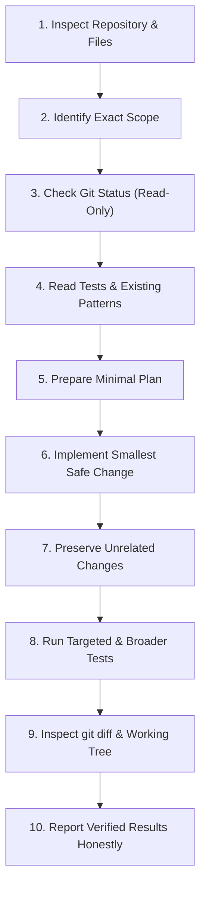
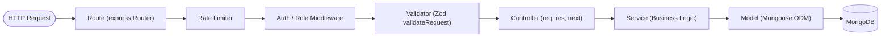
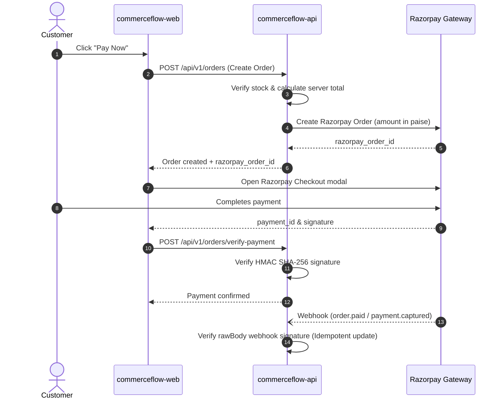

# CommerceFlow Development and Repository Rules (RULES.md)

> **Document Status**: Authoritative Repository Standard
> **Repository Path**: `./RULES.md`
> **Applies To**: `commerceflow-api/`, `commerceflow-web/`, scripts, tooling, and all human and AI contributors
> **Last Updated**: October 2026
> **Baseline Git Branch**: `feature/admin-expansion-staging-prep` (Target: `main`)
> **Related Architecture Documentation**: [`PRD.md`](./PRD.md), [`ARCHITECTURE.md`](./ARCHITECTURE.md), [`DESIGN.md`](./DESIGN.md)

---

## Rule Taxonomy and Classification

Every guideline in this document is labeled using one of four strict classifications:

| Classification | Definition |
| :--- | :--- |
| **`[Existing Rule]`** | Already established, implemented, and enforced by current repository code, configuration, or automated test suites. |
| **`[Required Rule]`** | A mandatory engineering standard that all contributors and AI coding agents MUST follow going forward. |
| **`[Conditional Rule]`** | Applies only when a specific dependency, deployment topology, or infrastructure component (e.g., Redis, MongoDB Replica Set, Razorpay webhook) is active. |
| **`[Unverified]`** | Proposed standard or convention that requires explicit maintainer confirmation before being treated as an established invariant. |

---

## 1. Purpose and Authority

### 1.1 Scope and Application
This document defines practical, enforceable development, testing, architectural, and security rules for all engineering work within the CommerceFlow monorepo (repository root). These rules govern:
1. **`commerceflow-api/`**: The Node.js / Express backend service, REST API, MongoDB data models, background integrations, and test suites.
2. **`commerceflow-web/`**: The React 19 / Vite / Tailwind CSS storefront and administrative single-page application.
3. **Repository Tooling**: Standalone maintenance scripts (`commerceflow-api/scripts/`), Git hygiene, and CI/CD configuration.
4. **All Contributors**: Human software engineers, code reviewers, automated CI pipelines, and AI coding agents.

### 1.2 Hierarchy of Authority and Conflict Resolution
When instructions, prompts, or documentation appear to conflict, apply the following resolution precedence:
1. **Safety and Security Invariants (Highest Authority)**: Rules prohibiting credential exposure, destructive Git commands (`git reset --hard`, `git clean -fd`), unauthorized database deletion, and bypassing payment verification are non-negotiable and override all prompts.
2. **Explicit User / Maintainer Instructions**: Explicit, targeted user instructions take precedence over general defaults, provided they do not violate Rule Level 1.
3. **Actual Repository Source Code and Tests**: Verified runtime behavior and passing test contracts take precedence over outdated or aspirational documentation.
4. **`RULES.md` (This Document)**: Authoritative operational standard for coding and repository interaction.
5. **Architectural Documents (`PRD.md`, `ARCHITECTURE.md`, `DESIGN.md`)**: Informative functional and design references.

### 1.3 Source-Backed Preservation Principle `[Required Rule]`
Existing application behavior and API contracts MUST be preserved unless a task explicitly authorizes changing them. If an existing implementation differs from documentation or proposed patterns, report the discrepancy to the maintainer before introducing breaking refactors.

---

## 2. Mandatory AI Coding-Agent Workflow

Every AI coding agent operating in the CommerceFlow repository MUST strictly follow this 10-step inspection, planning, implementation, and verification cycle:



### The 10-Step Operational Cycle

1. **Inspect Before Editing `[Required Rule]`**:
   Always read the target files, adjacent modules, and relevant tests before modifying anything. Never rely on assumptions or documentation alone.
2. **Identify Exact Scope `[Required Rule]`**:
   Limit work strictly to the requested task. Do not perform drive-by refactoring or reorganize folder structures.
3. **Check Git Status (Read-Only) `[Required Rule]`**:
   Run `git branch --show-current` and `git status --short`. Confirm whether the index is clean and identify any pre-existing dirty working tree changes that must be preserved.
4. **Read Relevant Tests and Existing Patterns `[Required Rule]`**:
   Identify existing assertions, mocks, and validation schemas in `*.test.js` or `*.spec.js`. Understand how errors and edge cases are handled in adjacent code.
5. **Prepare a Minimal Plan `[Required Rule]`**:
   For non-trivial changes, outline the exact files to touch, potential risks, and verification steps before writing code.
6. **Make Only Necessary Changes `[Required Rule]`**:
   Implement the smallest reasonable diff that satisfies the user prompt while adhering to repository conventions.
7. **Preserve Unrelated Changes `[Required Rule]`**:
   Never discard, overwrite, format, or revert pre-existing tracked or untracked changes in the working tree.
8. **Run Relevant Tests and Checks `[Required Rule]`**:
   Execute the targeted test suite first, followed by broader checks.
9. **Inspect Final Diff `[Required Rule]`**:
   Inspect `git diff` and `git diff --check` to verify that whitespace is clean, no debugging logs or secrets were left behind, and only intended lines were modified.
10. **Report Results Honestly `[Required Rule]`**:
    State clearly which tests ran and passed, which were skipped or failed, what limitations remain, and confirm that no unauthorized Git staging, commits, or pushes occurred.

> [!CAUTION]
> **No Phantom Verification**: AI agents MUST NOT claim a test passed or a build succeeded unless the command was actually executed and its output verified in the session.

---

## 3. Scope Control and File Safety

| Action | Allowed / Prohibited | Rule Requirement |
| :--- | :---: | :--- |
| **Small, focused diffs** | **MUST** | Keep pull requests and edits minimal and relevant to the single objective. |
| **Drive-by refactoring** | **MUST NOT** | Do not refactor unrelated files, variable names, or architecture during a feature or bugfix task. |
| **Overwriting existing work** | **MUST NOT** | Never replace user work, untracked drafts, or work-in-progress files. |
| **Modifying lockfiles unnecessarily** | **MUST NOT** | Do not regenerate `package-lock.json` unless a dependency was explicitly approved for installation. |
| **Deleting project files** | **MUST NOT** | Never delete, rename, or move files without explicit, written confirmation from the user. |
| **Bulk code reformatting** | **MUST NOT** | Do not run repository-wide formatters (Prettier, ESLint `--fix`) that create massive, unreviewable diffs. |
| **Destructive test fixes** | **MUST NOT** | Never delete or weaken a failing test assertion merely to make a test suite pass. |

---

## 4. Git and Branch Safety

### 4.1 Git Invariants `[Required Rule]`
- **Never Run Destructive Commands**:
  - `git reset --hard` is strictly forbidden.
  - `git clean -fd` is strictly forbidden.
  - `git checkout -- .` or `git restore .` is strictly forbidden unless explicitly requested for a specific file.
- **Never Alter History or Force Push**:
  - `git push --force` or `--force-with-lease` is strictly forbidden.
  - Rebase, squash, or commit amendments altering shared branches are strictly forbidden without explicit maintainer approval.
- **No Unauthorized Commits or Staging**:
  - Agents MUST NOT run `git add`, `git commit`, `git push`, or switch branches unless explicitly requested by the user prompt. Creating or editing a file NEVER implies authorization to commit it.

### 4.2 Standard Verification Routine
When performing Git status verification, use read-only commands:
```bash
# 1. Check current branch
git branch --show-current

# 2. Check working tree status
git status --short

# 3. Check staged index
git diff --cached --stat

# 4. Check for whitespace or conflict markers
git diff --check
```

---

## 5. Code Quality and Maintainability

### 5.1 Architecture Stack Invariants `[Existing Rule]`
- **Backend Stack**: Node.js `>=20`, Express `5.2.1` (`type: "module"` ESM), Mongoose `9.9.5`, Zod `4.5.4`, Vitest `5.0.0`, Supertest `7.2.2`.
- **Frontend Stack**: React `19.2.8`, Vite `8.3.0`, Tailwind CSS `4.3.3` (`@tailwindcss/vite`), ESLint `10.11.0`.

### 5.2 Coding Standards
- **ESM Imports Only `[Existing Rule]`**: Both packages use native ES modules (`import`/`export`). Do not use CommonJS `require()` or `module.exports` in application source code.
- **Single Responsibility Functions `[Required Rule]`**: Functions should be small, focused, and do one thing well.
- **Self-Documenting Code `[Required Rule]`**: Choose clear, descriptive names for functions, variables, and parameters. Add comments only to explain *why* a non-obvious business decision or mathematical calculation was made, not *what* standard code does.
- **No Premature Abstraction `[Required Rule]`**: Avoid excessive design patterns, wrapper layers, or utility functions that are only used once. Prefer direct, readable code over clever meta-programming.
- **Consistent Error Propagation `[Required Rule]`**: Use Express `next(error)` in controllers or throw typed `ApiError` instances that the central error handler handles. Never silently swallow errors in empty `catch {}` blocks.

---

## 6. Backend Engineering Rules (`commerceflow-api`)

### 6.1 Layered Architecture Pattern `[Existing Rule]`
Backend code MUST strictly adhere to the layered separation of concerns:



1. **Routes (`src/routes/`, `src/modules/*/routes.js`)**:
   - Register HTTP verbs, path definitions, and wire up middleware pipelines.
   - Do NOT contain business logic or database queries.
   - All public endpoints are mounted under `/api/v1` via [`src/routes/index.js`](./commerceflow-api/src/routes/index.js).
2. **Validators (`src/validators/`, `src/modules/*/*.validator.js`)**:
   - Define declarative Zod schemas for `body`, `query`, and `params`.
   - Applied via the `validateRequest(schema)` middleware.
3. **Controllers (`src/controllers/`, `src/modules/*/*.controller.js`)**:
   - Extract validated inputs from `req.body`, `req.query`, `req.params`.
   - Delegate business logic to services.
   - Return standardized HTTP responses via `res.status(code).json({ success: true, data })`.
4. **Services (`src/services/`, `src/modules/*/*.service.js`)**:
   - Contain domain business logic, calculations, inventory checks, and third-party orchestration.
   - Independent of Express `req` and `res` objects.
5. **Models (`src/models/`, `src/modules/*/*.model.js`)**:
   - Mongoose schemas, indexes, hooks, and virtuals.

### 6.2 Authentication and Authorization `[Existing Rule]`
- **Protected Endpoints**: MUST use [`authenticate`](./commerceflow-api/src/common/middleware/auth.middleware.js) middleware to extract and verify the JWT from the `Authorization: Bearer <token>` header.
- **Admin Endpoints**: MUST chain [`authorize('admin')`](./commerceflow-api/src/common/middleware/authorize.middleware.js) after `authenticate`.
- **Dual-Role Model Invariant `[Existing Rule]`**: The system strictly supports two roles defined in [`user.model.js`](./commerceflow-api/src/modules/users/user.model.js): `'customer'` and `'admin'`. There is no `'superAdmin'`, `'vendor'`, or multi-tenant role.
- **Resource Ownership Enforcement `[Existing Rule]`**: For customer endpoints (`/api/v1/cart`, `/api/v1/orders`, `/api/v1/addresses`), customer ID MUST be extracted from `req.user.id` (`req.user._id`), NEVER trusted from `req.body.userId` or `req.params.userId`.

### 6.3 Input Validation and Safe Data Handling `[Existing Rule]`
- **Zod for Trust Boundaries**: Validate every client-supplied payload before reaching the controller.
- **MongoDB ObjectId Validation**: All route parameters representing IDs MUST be validated as valid 24-character hexadecimal MongoDB ObjectIds.
- **Query Pagination Limits `[Existing Rule]`**: Endpoints listing resources (products, orders, reviews) MUST enforce pagination parameters (`page`, `limit`) with a strict maximum limit (e.g., `limit <= 100`) to prevent denial-of-service memory exhaustion.
- **No Client Price Trust `[Existing Rule]`**: Client-provided product prices, discounts, or order totals MUST be ignored. Totals MUST be calculated server-side from active database records.

### 6.4 Error Handling and Response Structure `[Existing Rule]`
All API responses MUST follow standardized JSON envelopes:
- **Success Response**:
  ```json
  {
    "success": true,
    "data": { ... },
    "message": "Optional descriptive status message"
  }
  ```
- **Error Response**:
  ```json
  {
    "success": false,
    "message": "User-safe error description",
    "errors": [ ... ],
    "requestId": "cuid-or-uuid"
  }
  ```
- **Centralized Error Handler `[Existing Rule]`**: Implemented in [`error.middleware.js`](./commerceflow-api/src/common/middleware/error.middleware.js). In production (`NODE_ENV === 'production'`), internal database errors, Mongoose connection strings, and stack traces MUST NEVER be returned to the client.

### 6.5 Logging Invariants `[Existing Rule]`
- Use **Pino** (`pino-http`) for structured JSON logging.
- **Redaction Policy**: Passwords, authorization tokens, JWT secrets, credit card numbers, and Razorpay secrets MUST NEVER be written to logs.

---

## 7. Frontend Engineering Rules (`commerceflow-web`)

### 7.1 Architecture and Routing `[Existing Rule]`
- **Client-Side SPA**: Built with React 19 and Vite 8. Custom router and view dispatching are configured in [`src/App.jsx`](./commerceflow-web/src/App.jsx).
- **Layout Segregation**:
  - Storefront views use the main header/footer navigation shell in `App.jsx`.
  - Administrative views are wrapped in [`AdminLayout.jsx`](./commerceflow-web/src/layouts/AdminLayout.jsx), providing the persistent responsive sidebar, breadcrumbs, search, and admin profile bar.
- **Feature Service Pattern `[Existing Rule]`**: UI components MUST NOT call `fetch` directly. All network requests MUST go through dedicated feature services in `src/features/` or the centralized client in [`apiClient.js`](./commerceflow-web/src/lib/apiClient.js).

### 7.2 Component State and UI Feedback `[Required Rule]`
Every asynchronous component or data-driven view MUST explicitly implement and test 5 visual states:
1. **Loading State**: Visual skeleton or accessible spinner while data is in flight; buttons disabled to prevent double-submissions.
2. **Error State**: User-friendly error alert with an actionable retry button when requests fail.
3. **Empty State**: Clear, illustrated empty message with a call-to-action when lists have zero items.
4. **Success State**: Clear feedback (toast, banner, or badge update) upon mutation completion.
5. **Disabled State**: Interactive controls disabled when permissions are lacking or validation fails.

### 7.3 Frontend Truth and Prototype Labeling `[Required Rule]`
- **Server Authority**: The frontend is a presentation layer. Never assume an operation succeeded until the server returns an HTTP 2xx response.
- **No Misleading Fake Fallbacks**: Do not display mock fallback data when a real API request fails without explicitly informing the user that offline/mock data is shown.
- **Prototype Feature Disclosure `[Required Rule]`**:
  Certain administrative views in `commerceflow-web` operate on client-side state:
  - `AdminFinancePage.jsx`: Uses browser `localStorage` for wallet balances and expenses.
  - `AdminCampaignsPage.jsx`: Uses browser `localStorage` for marketing campaigns.
  - `AdminAchievementsPage.jsx`: Uses static in-memory objects.
  These views MUST display an honest "Client Prototype / Non-Persistent" badge or banner so contributors and users understand the data does not persist to MongoDB.

### 7.4 Accessibility and Styling `[Required Rule]`
- **Semantic HTML**: Use native semantic tags (`<header>`, `<nav>`, `<main>`, `<aside>`, `<section>`, `<footer>`, `<button>`).
- **Form Controls**: Every `<input>`, `<select>`, and `<textarea>` MUST have an associated `<label>` or `aria-label`.
- **Keyboard Navigation**: Modals and dropdowns MUST handle keyboard focus management and `Escape` key closure.
- **Tailwind CSS v4 `[Existing Rule]`**: Use Tailwind utility classes via `@tailwindcss/vite`. Avoid arbitrary one-off inline CSS styles when standardized Tailwind tokens exist.

---

## 8. Security and Secrets Management

### 8.1 Zero-Tolerance Secrets Policy `[Required Rule]`
- **No Secrets in Source Code**: Passwords, JWT signing secrets, API keys, webhook secrets, database connection strings, and certificates MUST NEVER be committed to Git.
- **Environment Files**:
  - `.env` MUST remain in `.gitignore` and NEVER be tracked.
  - `.env.example` in both `commerceflow-api/` and `commerceflow-web/` MUST serve as the sole documented schema, using safe placeholders (e.g., `YOUR_RAZORPAY_KEY_ID`, `YOUR_JWT_SECRET`).
- **No Secrets in Test Fixtures**: Test files MUST use ephemeral mock secrets (e.g., `test-jwt-secret-do-not-use-in-production`).

### 8.2 Defense in Depth `[Required Rule]`
- **Server-Side Authorization**: UI hiding of buttons (e.g., hiding "Delete Product" from customers) is purely cosmetic. Every privileged operation MUST be protected by backend middleware.
- **Injection Prevention**: Use Mongoose query builders with explicit schema casting. Do not pass unsanitized query parameters directly into `$where` or regex constructors.
- **Timing-Safe Cryptography `[Existing Rule]`**: Comparison of cryptographic tokens, webhook signatures, and password verification hashes MUST use `crypto.timingSafeEqual` to prevent timing attacks.

---

## 9. Database and Data Integrity Rules

### 9.1 Schema and Model Conventions `[Existing Rule]`
- All schemas MUST include `{ timestamps: true }` (`createdAt`, `updatedAt`).
- Compound indexes MUST be defined in Mongoose schema definitions and match real query access patterns (e.g., `{ user: 1, createdAt: -1 }`).

### 9.2 Concurrency and Atomic Operations `[Existing Rule]`
- **Atomic Stock Management**: Inventory deductions and cancellations MUST use atomic MongoDB operators:
  ```javascript
  // Atomic decrement verifying sufficient stock
  const result = await Product.findOneAndUpdate(
    { _id: productId, stock: { $gte: quantity } },
    { $inc: { stock: -quantity } },
    { new: true }
  );
  if (!result) throw new ApiError(400, 'Insufficient inventory');
  ```
- **Replica Sets vs. Standalone MongoDB `[Conditional Rule]`**:
  Multi-document ACID transactions (`session.withTransaction()`) require a MongoDB Replica Set deployment. Standalone MongoDB instances (common in local development) do not support multi-document transactions. Therefore:
  - Do NOT introduce `mongoose.startSession()` multi-document transactions unless the deployment environment is verified to support replica sets.
  - Use atomic document updates and compensating rollback logic for single-instance compatibility.

### 9.3 Database Mutation Safeguards `[Existing Rule]`
Administrative CLI scripts modifying database records (e.g., [`create-admin.js`](./commerceflow-api/scripts/create-admin.js), [`promote-admin.js`](./commerceflow-api/scripts/promote-admin.js)) MUST use [`safety-helper.js`](./commerceflow-api/scripts/safety-helper.js):
1. Block execution unconditionally if `NODE_ENV === 'production'` without explicit override.
2. Verify interactive terminal confirmation (`process.stdin.isTTY`).
3. Refuse execution against target databases containing `'prod'` or `'production'` without confirmation.

---

## 10. Payments, Webhooks, and Financial Operations

### 10.1 Razorpay Integration Architecture `[Existing Rule]`
CommerceFlow uses **Razorpay** as its payment gateway.



### 10.2 Financial Security Invariants
- **Amounts in Smallest Currency Unit `[Existing Rule]`**: Razorpay operates in INR paise. Amounts MUST be converted server-side using `Math.round(totalInRupees * 100)`. Never accept amount or currency from the frontend.
- **Client Signature Verification `[Existing Rule]`**:
  ```javascript
  const expectedSignature = crypto
    .createHmac('sha256', process.env.RAZORPAY_KEY_SECRET)
    .update(`${razorpay_order_id}|${razorpay_payment_id}`)
    .digest('hex');

  const isValid = crypto.timingSafeEqual(
    Buffer.from(expectedSignature, 'utf-8'),
    Buffer.from(razorpay_signature, 'utf-8')
  );
  ```
- **Webhook Raw Body Invariant `[Existing Rule]`**:
  Webhook signatures MUST be verified against the unmodified raw request body buffer (`req.rawBody`). Express `body-parser` JSON middleware MUST preserve the raw buffer.
- **Idempotent Webhook Processing `[Existing Rule]`**:
  Webhook handlers MUST verify whether an order is already marked `'paid'` before re-triggering stock deductions or dispatch events. Duplicate events MUST return HTTP `200 OK` without side effects.
- **No Live Transactions in Tests `[Required Rule]`**:
  Test suites MUST mock the Razorpay SDK (`razorpay` package). Live payment keys MUST NEVER be used in automated tests.

---

## 11. Testing and Verification Standards

### 11.1 Package Test Commands `[Existing Rule]`
Contributors MUST use verified package scripts from `package.json`:

| Subproject | Task | Verified Script Command |
| :--- | :--- | :--- |
| **`commerceflow-api`** | Run full test suite | `cd commerceflow-api && npm test` (`vitest run`) |
| **`commerceflow-api`** | Targeted single test | `cd commerceflow-api && npx vitest run <path/to/test>` |
| **`commerceflow-api`** | Watch mode | `cd commerceflow-api && npm run test:watch` |
| **`commerceflow-web`** | Run full test suite | `cd commerceflow-web && npm test` (`node scripts/run-tests.js`) |
| **`commerceflow-web`** | Linting | `cd commerceflow-web && npm run lint` (`eslint .`) |
| **`commerceflow-web`** | Production build check | `cd commerceflow-web && npm run build` (`vite build`) |

### 11.2 Current Known Baseline Metrics `[Existing Rule]`
As of October 2026:
- **Backend Test Baseline**: **117 test files**, **1,810 tests passing**, **18 skipped** (tests requiring live Redis or standalone replica sets).
- **Frontend Test Baseline**: **191 test suites**, **733 tests passing**.

### 11.3 Mandatory Test Coverage Requirements `[Required Rule]`
When modifying or adding features:
1. **Happy Path**: Test successful execution with standard inputs.
2. **Validation Failure**: Test invalid, missing, or malformed body, query, and parameter fields.
3. **Authorization Failure**: Test unauthenticated requests (401) and unauthorized role requests (403).
4. **Boundary & Edge Cases**: Test zero quantity, duplicate keys, maximum strings, and not-found resources (404).
5. **Regression Coverage**: Every bug fix MUST be accompanied by a dedicated test reproducing the defect and asserting the fix.

---

## 12. API and Contract Compatibility

### 12.1 Backward Compatibility Invariant `[Required Rule]`
Existing API routes and payloads MUST remain backward-compatible:
- Do NOT remove existing response fields. If a field is deprecated, retain it and document its deprecation.
- New required request fields MUST NOT be added to existing endpoints without maintaining support for older clients or bumping the API version.
- When endpoint contracts change, corresponding updates to frontend service layers and documentation (`PRD.md`, `ARCHITECTURE.md`) MUST be included in the same task.

---

## 13. Configuration and Environment Management

### 13.1 Mandatory Environment Variables Schema `[Existing Rule]`

#### Backend (`commerceflow-api/.env`)
| Variable | Required | Description | Example / Default |
| :--- | :---: | :--- | :--- |
| `NODE_ENV` | Yes | Runtime environment | `development` / `production` / `test` |
| `PORT` | No | Server listen port | `5000` |
| `MONGODB_URI` | Yes | MongoDB connection string | `mongodb://localhost:27017/commerceflow` |
| `JWT_SECRET` | Yes | Token signing secret | Strong random string (min 32 chars) |
| `JWT_EXPIRES_IN` | No | Token lifetime | `7d` |
| `RAZORPAY_KEY_ID` | Yes | Razorpay API Key ID | `rzp_test_...` |
| `RAZORPAY_KEY_SECRET` | Yes | Razorpay API Key Secret | Secret key string |
| `RAZORPAY_WEBHOOK_SECRET` | Yes | Webhook verification secret | Secret webhook string |
| `REDIS_URL` | No | Redis caching endpoint | `redis://localhost:6379` (fallback to memory) |
| `CORS_ORIGIN` | No | Permitted CORS frontend origins | `http://localhost:5173` |

#### Frontend (`commerceflow-web/.env`)
| Variable | Required | Description | Example / Default |
| :--- | :---: | :--- | :--- |
| `VITE_API_URL` | No | Backend API base URL | `http://localhost:5000/api/v1` |

### 13.2 Fail-Closed Principle `[Required Rule]`
If a required environment variable is missing on server startup in production, the application MUST log a fatal error and exit cleanly (`process.exit(1)`), rather than falling back to an insecure default secret.

---

## 14. Documentation Rules

### 14.1 Documentation Integrity `[Required Rule]`
- **Codebase is Ground Truth**: Documentation MUST reflect real, implemented code. Never document theoretical or planned features as working realities.
- **Accurate File References**: When linking to files in markdown, use portable repository-relative links: `[filename](./path/to/file.ext)`.
- **Maintain Synchronization**: When modifying data models, routes, or design tokens, update the relevant sections in:
  - [`PRD.md`](./PRD.md)
  - [`ARCHITECTURE.md`](./ARCHITECTURE.md)
  - [`DESIGN.md`](./DESIGN.md)
  - [`RULES.md`](./RULES.md)

---

## 15. Dependencies and Generated Artifacts

### 15.1 Dependency Policy `[Required Rule]`
- **No Unapproved Packages**: Never install new npm packages (`npm install <pkg>`) without explicit approval from the project maintainer.
- **Evaluate Existing Capabilities**: Before requesting a new dependency, verify whether Node.js built-ins (`crypto`, `fs`, `path`, `stream`) or existing packages (`zod`, `pino`, `mongoose`) already provide the capability.
- **Lockfile Hygiene**: Commit `package-lock.json` changes only when dependencies are intentionally added or removed.
- **Generated Output**: Build artifacts (`dist/`, `.vite/`, coverage reports, logs) MUST remain in `.gitignore` and NEVER be tracked in Git.

---

## 16. Pull Request and Completion Reporting

Every completion summary or Pull Request description MUST provide an honest, structured report following this checklist:

```markdown
### Summary of Changes
- [Concise description of the functional change]

### Affected Files
- `commerceflow-api/path/to/file.js`
- `commerceflow-web/path/to/component.jsx`

### Verification and Test Execution
- [ ] Backend tests run: `npm test` -> Result: X passed, Y failed, Z skipped
- [ ] Frontend tests run: `npm test` -> Result: X passed, Y failed
- [ ] Linter checks: `npm run lint` -> Clean
- [ ] Static type / build check: `npm run build` -> Clean

### Git and Working Tree State
- Active Branch: [e.g., feature/admin-expansion-staging-prep]
- Index Status: Clean (0 staged files)
- Unrelated Changes Preserved: [Yes/No]
- Unauthorized Commits / Pushes: None

### Known Risks, Limitations, or Unresolved Items
- [Disclose any skipped tests, assumptions, or future work required]
```

---

## 17. Definition of Done (DoD)

A task in CommerceFlow is considered **DONE** only when all of the following criteria are met:

- [ ] **Scope Satisfied**: The requested task is completely implemented without scope creep.
- [ ] **Minimal Diff**: Only necessary files were touched; no unrelated refactoring or bulk formatting.
- [ ] **Safety Preserved**: All pre-existing tracked and untracked changes remain intact.
- [ ] **Tests Passing**: Relevant targeted tests and regression tests pass without weakening assertions.
- [ ] **Zero Secrets**: No tokens, credentials, or personal data were introduced or logged.
- [ ] **Contracts Maintained**: Backend REST contracts and frontend API services remain aligned.
- [ ] **Documentation Updated**: Discrepancies resolved and documentation updated where appropriate.
- [ ] **Git Operations Clean**: No unprompted commits, pushes, merges, or resets occurred.

---

## 18. Open Questions and Future Recommendations

The following items represent architectural conventions and decisions requiring maintainer consensus:

1. **MongoDB Replica Set Support for Multi-Document Transactions `[Conditional Rule]`**:
   - *Current Reality*: Standalone MongoDB instances are used in local development. Multi-document transactions (`session.withTransaction()`) fail on standalone instances.
   - *Recommendation*: Establish a staging MongoDB replica set to enable true multi-document transactions for complex checkout stock reservation flows.
2. **Migration of Administrative Client Prototypes `[Unverified]`**:
   - *Current Reality*: Finance (wallets/expenses), Campaigns, and Achievements pages in `commerceflow-web` use browser `localStorage` or in-memory arrays.
   - *Recommendation*: Design and implement backend REST endpoints (`/api/v1/admin/finance`, `/api/v1/admin/campaigns`) to provide persistent database storage for these modules.
3. **Role Granularity Expansion `[Unverified]`**:
   - *Current Reality*: The platform strictly supports `'customer'` and `'admin'`.
   - *Recommendation*: If administrative teams grow, evaluate adding granular permission scopes (e.g., `'support_agent'`, `'finance_manager'`) while maintaining strict server-side validation.
4. **Monorepo Workspace Tooling `[Unverified]`**:
   - *Current Reality*: The repository contains two decoupled packages without a root `package.json`.
   - *Recommendation*: Evaluate introducing npm workspaces or Turborepo at the root to streamline unified linting, testing, and dependency updates across both subprojects.
