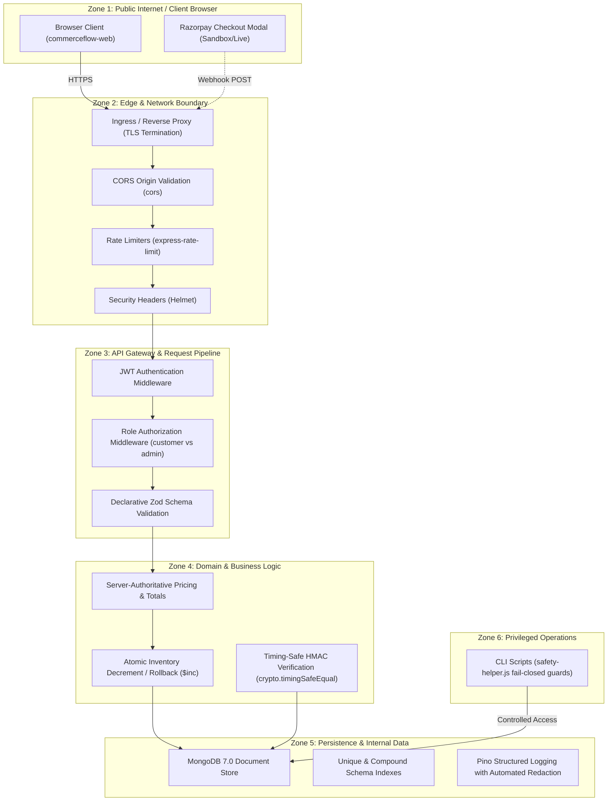

# CommerceFlow Security Policy and Security Architecture (SECURITY.md)

> **Document Status**: Authoritative Security Policy & Architecture Reference
> **Repository Root**: repository root
> **Last-Reviewed Date**: October 14, 2026
> **Active Baseline Branch**: `feature/admin-expansion-staging-prep` (Target: `main`)
> **Related Architecture Documentation**: [`PRD.md`](./PRD.md) · [`ARCHITECTURE.md`](./ARCHITECTURE.md) · [`RULES.md`](./RULES.md) · [`TASKS.md`](./TASKS.md) · [`DECISIONS.md`](./DECISIONS.md) · [`TEST_PLAN.md`](./TEST_PLAN.md)

---

## 1. Purpose and Scope

### 1.1 Purpose
This document defines the security architecture, threat model, active defenses, verified operational safeguards, and responsible reporting procedures for the CommerceFlow platform. It provides contributors, security reviewers, release engineers, and AI coding agents with a rigorous, evidence-based reference for building and maintaining a secure e-commerce system.

### 1.2 Scope
This policy covers all components in the monorepo:
1. **Backend API (`commerceflow-api`)**: Express 5 application, REST endpoints under `/api/v1`, authentication and authorization middleware, payment gateway orchestration, and background integrations.
2. **Frontend SPA (`commerceflow-web`)**: React 19 / Vite client, route boundaries, authentication state management, and administrative interfaces.
3. **Database and Persistence**: MongoDB schemas, index definitions, and atomic document operations.
4. **Tooling and Infrastructure**: Standalone CLI administration scripts (`commerceflow-api/scripts/`), Docker configuration, CI workflows, and environment schemas.

### 1.3 Evidence-First Taxonomy
Every control in this document is labeled using one of six precise evidentiary classifications:

| Classification | Definition |
| :--- | :--- |
| **`[Verified implementation]`** | Confirmed present and active in current application source code or configuration. |
| **`[Tested behavior]`** | Verified by an automated test in the repository with a documented passing result. |
| **`[Deployment-dependent]`** | Relies on external hosting, cloud topology, TLS proxies, or runtime secrets management. |
| **`[Known gap]`** | A confirmed architectural limitation, defect, or missing security control supported by evidence. |
| **`[Needs verification]`** | Implementation exists or is documented, but requires runtime or staging confirmation. |
| **`[Recommendation]`** | A proposed security hardening measure; not an active or approved control. |

---

## 2. Security Architecture Overview

CommerceFlow enforces layered defense-in-depth across six distinct trust zones:



*For comprehensive sequence flows and topological diagrams, refer to [`ARCHITECTURE.md`](./ARCHITECTURE.md).*

---

## 3. Authentication and Session Security

### 3.1 Token and Password Handling
- **JWT Authentication `[Verified implementation]`**:
  Authentication uses JSON Web Tokens signed with HMAC SHA-256 (`HS256`). Clients transmit tokens via the standard header:
  `Authorization: Bearer <token>`
  Middleware [`auth.middleware.js`](./commerceflow-api/src/common/middleware/auth.middleware.js) verifies the signature using `JWT_SECRET` and populates `req.user` with `id`, `email`, and `role`.
- **Bcrypt Password Hashing `[Verified implementation]` `[Tested behavior]`**:
  Passwords are encrypted before storage in [`user.model.js`](./commerceflow-api/src/modules/users/user.model.js) using `bcryptjs` with a cost factor (salt rounds) of 12. Plaintext passwords are never persisted.
- **Timing-Safe Credential Verification `[Verified implementation]`**:
  User authentication relies on `bcrypt.compare`, mitigating CPU timing variations during password evaluation.
- **Token Expiry Configuration `[Verified implementation]`**:
  Token expiration defaults to 20 minutes (`JWT_EXPIRES_IN: "20m"`), configured and validated in [`src/config/env.js`](./commerceflow-api/src/config/env.js).

### 3.2 Authentication Defense Limits and Known Gaps
- **Brute Force Protection `[Tested behavior]`**:
  Rapid authentication attempts are throttled by `authRateLimitMiddleware` (max 10 requests per 15 minutes per IP), returning HTTP 429 `AUTH_RATE_LIMIT_EXCEEDED` ([`auth-rate-limit.middleware.test.js`](./commerceflow-api/src/common/middleware/auth-rate-limit.middleware.test.js)).
- **Stateless Revocation Gap `[Known gap]`**:
  JWTs are stateless; no server-side token denylist or Redis-backed session tracking is implemented. Compromised tokens remain valid until their expiration window lapses unless the server's `JWT_SECRET` is rotated.
- **Account Recovery Gap `[Known gap]`**:
  No automated password reset, forgot-password email loop, or multi-factor authentication (MFA) endpoints are implemented in the API.

---

## 4. Authorization and Role Enforcement

### 4.1 Strict Dual-Role Model `[Verified implementation]`
CommerceFlow enforces a single-merchant dual-role architecture defined in [`user.model.js`](./commerceflow-api/src/modules/users/user.model.js):
- `'customer'`: Standard registered user (default).
- `'admin'`: Administrative operator with back-office access.

> [!IMPORTANT]
> **No Intermediate Roles**: The backend recognizes NO intermediate roles such as `'superAdmin'`, `'vendor'`, `'store_manager'`, or `'editor'`.

### 4.2 Server-Side Authorization Invariants
- **Admin Endpoint Protection `[Verified implementation]` `[Tested behavior]`**:
  All administrative routes under `/api/v1/admin/*` chain [`authorize('admin')`](./commerceflow-api/src/common/middleware/authorize.middleware.js). Unauthenticated requests return HTTP 401; authenticated requests with role `'customer'` return HTTP 403 `FORBIDDEN_RESOURCE` ([`user-role-auth.test.js`](./commerceflow-api/src/modules/users/user-role-auth.test.js)).
- **Resource Ownership Scoping `[Verified implementation]`**:
  For customer commerce resources (Cart, Orders, Addresses, Wishlist), ownership is enforced server-side. Queries strictly scope database access using `req.user.id`:
  ```javascript
  // Secure ownership enforcement in order.service.js
  const order = await Order.findOne({ _id: orderId, user: req.user.id });
  if (!order) throw new ApiError(404, 'ORDER_NOT_FOUND');
  ```
- **Cosmetic UI Prototype Disclosure `[Known gap]`**:
  Administrative views such as `AdminRolesPage.jsx` present client-side mock configurations for fine-grained permissions (`Order Manager`, `Support Specialist`). These permissions are NOT backed by backend schemas and provide zero authorization enforcement.

---

## 5. Input Validation and Injection Prevention

### 5.1 Declarative Schema Boundaries `[Verified implementation]` `[Tested behavior]`
- **Zod Validation Middleware**: All HTTP endpoints validate `body`, `query`, and `params` via [`validate.middleware.js`](./commerceflow-api/src/common/middleware/validate.middleware.js). Invalid types, missing required keys, or malformed data are rejected with HTTP 400 `VALIDATION_ERROR` before controller dispatch.
- **NoSQL Injection Defense**: MongoDB query selectors (e.g., `{"$gt": ""}`) passed in JSON bodies are rejected because Zod strictly casts and validates primitive types (strings, numbers, booleans).
- **ObjectId Format Enforcement**: All route parameters representing entity identifiers are validated as 24-character hexadecimal MongoDB ObjectIds.
- **Pagination Protection**: Query parameters `page` and `limit` are clamped. Unbounded queries cannot be triggered by clients; `limit` is capped at 100 items.

### 5.2 Validation Gaps & Nuances
- **Strict DELETE Body Requirement `[Known gap]`**:
  Schemas in `cart.validator.js` and `wishlist.validator.js` define `body: z.object({})` without `.optional()`. Standard body-less HTTP DELETE requests from mobile or cURL clients fail with HTTP 400 `VALIDATION_ERROR` unless an explicit `{}` body is provided ([`BLK-002`](./TASKS.md#blk-002)).
- **Banner Target URL Validation `[Known gap]`**:
  Banner schemas accept target URL strings without strictly restricting protocols to `https://`. Allowing unrestricted protocol schemes introduces potential risks of open redirects or `javascript:` URI injection.

---

## 6. API and Network Security

### 6.1 Application-Level Defenses
- **HTTP Security Headers (Helmet) `[Verified implementation]`**:
  Express app initializes `helmet()` in [`src/app.js`](./commerceflow-api/src/app.js), enforcing:
  - `X-Content-Type-Options: nosniff` (MIME-type sniffing defense).
  - `X-Frame-Options: SAMEORIGIN` (Clickjacking mitigation).
  - `Content-Security-Policy` default restrictions.
  - `x-powered-by` header disabled.
- **Cross-Origin Resource Sharing (CORS) `[Verified implementation]` `[Tested behavior]`**:
  Configured in [`src/app.js`](./commerceflow-api/src/app.js) using whitelist origins parsed from `CORS_ORIGIN`. In production (`NODE_ENV === 'production'`), wildcard `'*'` is forbidden by [`src/config/env.js`](./commerceflow-api/src/config/env.js). Disallowed origins yield `access-control-allow-origin: null`.
- **Payload Size Limits `[Verified implementation]`**:
  Express JSON parser enforces `limit: '1mb'` to prevent memory exhaustion DoS attacks from bloated request payloads.
- **Multi-Tier Rate Limiting `[Verified implementation]` `[Tested behavior]`**:
  - Global API Limiter: 100 requests per 15-minute window per IP.
  - Auth Limiter: 10 requests per 15-minute window per IP on login/registration routes.
  - Webhook Limiter: 60 requests per 15-minute window per IP on payment webhook endpoints.

### 6.2 Deployment & Network Boundary Dependencies
- **Distributed Rate Limiting `[Deployment-dependent]` `[Known gap]`**:
  Rate limiters currently use in-memory storage (`MemoryStore`). Under horizontal scaling with multiple container instances behind a load balancer, rate limits are per-container rather than globally synchronized.
- **Reverse Proxy Trust `[Deployment-dependent]`**:
  Accurate client IP extraction for rate limiting relies on `TRUST_PROXY=1`. Ingress proxies must strip or overwrite untrusted incoming `X-Forwarded-For` headers.

---

## 7. Secrets and Configuration Management

### 7.1 Secrets Invariants `[Mandatory]`
1. **Never Commit Secrets**: Real credentials, passwords, JWT secrets, database connection URIs, and payment keys MUST NEVER be committed to Git.
2. **Environment File Hygiene `[Verified implementation]`**:
   - `.env` and `.env.local` are explicitly excluded in [`.gitignore`](./.gitignore).
   - `.env.example` in both subprojects documents required variable names using safe placeholders only (e.g., `YOUR_JWT_SECRET`, `YOUR_RAZORPAY_KEY_ID`).
3. **Fail-Closed Startup Validation `[Verified implementation]` `[Tested behavior]`**:
   [`src/config/env.js`](./commerceflow-api/src/config/env.js) parses environment variables on boot via Zod:
   - Terminate startup if `JWT_SECRET` is shorter than 32 characters.
   - Terminate startup if `RAZORPAY_KEY_SECRET` is missing.
   - Terminate startup in production if default placeholder secrets are detected.
4. **Public Frontend Variables Warning `[Verified implementation]`**:
   All variables prefixed with `VITE_` in `commerceflow-web` are baked into public client JavaScript bundles. Backend secrets (`MONGODB_URI`, `JWT_SECRET`, `RAZORPAY_KEY_SECRET`) must NEVER be placed in frontend environment files.

---

## 8. Database and Data Protection

### 8.1 Data Modeling and Access Safety
- **Schema Validation & Indexes `[Verified implementation]`**:
  Mongoose models enforce strict schema types and compound indexes. Unique indexes prevent duplicate accounts (`users.email`), duplicate carts (`carts.user`), and duplicate webhook events (`webhookevents.eventId`).
- **Sanitized Error Mapping `[Verified implementation]`**:
  [`src/common/middleware/error.middleware.js`](./commerceflow-api/src/common/middleware/error.middleware.js) intercepts MongoDB exceptions:
  - Error code 11000 (duplicate key) $\rightarrow$ HTTP 409 `DUPLICATE_RESOURCE`.
  - CastError (invalid ObjectId) $\rightarrow$ HTTP 400 `INVALID_ID`.
  - Stack traces and internal connection strings are suppressed in production mode.
- **Graceful Shutdown `[Verified implementation]` `[Tested behavior]`**:
  [`src/common/process-handlers.js`](./commerceflow-api/src/common/process-handlers.js) listens for `SIGTERM`/`SIGINT`, closes the HTTP listener, and calls `disconnectMongoDB()` cleanly with a 10-second safety force-exit timer.

### 8.2 Database Infrastructure Limitations
- **Encryption at Rest `[Deployment-dependent]`**:
  Data-at-rest encryption is not handled at the application layer; it is an infrastructure requirement for the managed MongoDB host (e.g., MongoDB Atlas volume encryption).
- **Automated Backups `[Deployment-dependent]`**:
  Point-in-time recovery and snapshot schedules must be configured on the database host; no application-level backup scripts exist.

---

## 9. Payment and Webhook Security

### 9.1 Server-Authoritative Financial Pipeline `[Verified implementation]`
- **Zero Client Price Trust**:
  Client-supplied product prices, subtotal calculations, or payment totals in request payloads are completely ignored. The order total is calculated on the server from active catalog database records.
- **Integer Paise Conversion `[Verified implementation]` `[Tested behavior]`**:
  To prevent floating-point rounding exploits, totals are converted to Indian paise integers using `toPaise(total)` (`Math.round(total * 100)`). Razorpay orders are generated exclusively with this server-calculated value.

### 9.2 Cryptographic Verification and Idempotency
- **Timing-Safe HMAC Verification `[Verified implementation]` `[Tested behavior]`**:
  Client payment verification hashes are compared using `crypto.timingSafeEqual`:
  ```javascript
  const expectedSignature = crypto
    .createHmac('sha256', process.env.RAZORPAY_KEY_SECRET)
    .update(`${razorpay_order_id}|${razorpay_payment_id}`)
    .digest('hex');

  const isValid = crypto.timingSafeEqual(
    Buffer.from(expectedSignature, 'utf-8'),
    Buffer.from(razorpay_signature, 'utf-8')
  );
  if (!isValid) throw new ApiError(400, 'INVALID_PAYMENT_SIGNATURE');
  ```
- **Webhook Raw Body Buffer Preservation `[Verified implementation]`**:
  [`src/app.js`](./commerceflow-api/src/app.js) captures the unmodified raw request buffer on `req.rawBody` during body-parser execution. Webhook signatures are verified against this raw buffer, ensuring signatures are not broken by JSON re-serialization.
- **Webhook Idempotency Tracking `[Verified implementation]` `[Tested behavior]`**:
  Processed webhook event IDs are saved in the `WebhookEvent` model with a unique index on `eventId`. Retried or duplicate events return HTTP 200 without re-executing order updates or stock mutations.

---

## 10. Admin Scripts and Privileged Operations

### 10.1 Safety Helper Fail-Closed Controls `[Verified implementation]` `[Tested behavior]`
Standalone administrative bootstrap scripts ([`create-admin.js`](./commerceflow-api/scripts/create-admin.js), [`promote-admin.js`](./commerceflow-api/scripts/promote-admin.js)) are guarded by [`scripts/safety-helper.js`](./commerceflow-api/scripts/safety-helper.js):
1. **Production Lock**: Unconditionally halts process execution if `NODE_ENV === 'production'` unless explicit `--force-production` flag is passed.
2. **Database Target Safeguard**: Inspects the target database name; halts if the name contains `'prod'` or `'production'` without confirmation.
3. **Interactive Terminal Check**: Verifies `process.stdin.isTTY` or requires explicit script confirmation flags (`--yes`).

---

## 11. Commerce-Specific Security Controls

| Business Domain | Threat Vector | Implemented Safeguard | Status |
| :--- | :--- | :--- | :---: |
| **Inventory** | Race condition overselling | Atomic decrement with stock availability check: `{ stock: { $gte: qty } }, { $inc: { stock: -qty } }` | `[Verified implementation]` |
| **Orders** | Historical price tampering | Product name and unit price snapshotted into `order.items` at checkout time | `[Verified implementation]` |
| **Coupons** | Discount abuse / Expiry bypass | Server-side validation of active dates, usage limits, and minimum order values | `[Verified implementation]` |
| **Reviews** | Fake reviews / Rating poisoning | Reviews require purchase verification; pending reviews require admin approval | `[Verified implementation]` |
| **Ratings** | Mathematical drift | Product `averageRating` and `reviewCount` recalculated on approval/deletion hooks | `[Verified implementation]` |

---

## 12. Logging, Monitoring, and Incident Response

### 12.1 Pino Structured Logging and Redaction `[Verified implementation]`
All backend logging is channeled through Pino (`src/common/logger.js`). The logger automatically redacts sensitive paths, replacing values with `"[REDACTED]"`:
- `password`, `*.password`
- `token`, `*.token`, `refreshToken`
- `authorization`
- `cookie`
- `razorpaySignature`, `x-razorpay-signature`
- Credit card and CVV fields

### 12.2 Incident Response & Credential Compromise Protocol `[Recommendation]`
If secrets (e.g., `JWT_SECRET`, `RAZORPAY_KEY_SECRET`) are suspected to have leaked:
1. **Revoke and Rotate**: Immediately rotate the secret in the cloud hosting secrets vault.
2. **Restart Services**: Trigger a zero-downtime container restart to ingest new environment variables.
3. **Invalidate Active Sessions**: Rotating `JWT_SECRET` invalidates all existing customer and admin JWT tokens, forcing re-authentication.
4. **Audit Logs**: Inspect container logs using correlated `requestId` traces to evaluate affected records.

---

## 13. Dependency and Supply-Chain Security

- **Deterministic Lockfiles `[Verified implementation]`**: Both subprojects track `package-lock.json` to ensure reproducible builds across developer and container environments.
- **Automated CI Auditing `[Verified implementation]`**: Backend CI workflow ([`.github/workflows/ci.yml`](./commerceflow-api/.github/workflows/ci.yml)) executes `npm audit` on every push and pull request to the `main` branch.
- **Minimal Base Container Image `[Verified implementation]`**: Backend Dockerfile builds from `node:22-alpine`, runs `npm ci --omit=dev`, and drops root privileges to `USER node`.
- **Known Dependency Advisory `[Known gap]`**:
  A moderate-severity audit advisory exists for indirect dependency `ip-address` ($\le 10.7.0$). Remediation is tracked in [`TASKS.md`](./TASKS.md#sec-005).

---

## 14. Security Testing and Verification Checklist

| Security Check | Expected Outcome | Verification Status |
| :--- | :--- | :---: |
| **Unauthenticated Request** | `GET /api/v1/users/me` without Bearer token returns HTTP 401 | `[Tested behavior]` |
| **Role Restriction** | Customer token on `GET /api/v1/admin/orders` returns HTTP 403 | `[Tested behavior]` |
| **Rate Limit Trigger** | $>10$ rapid logins return HTTP 429 `AUTH_RATE_LIMIT_EXCEEDED` | `[Tested behavior]` |
| **Timing-Safe Payments** | Altered payment signature fails timing-safe comparison | `[Tested behavior]` |
| **Idempotent Webhooks** | Duplicate webhook event ID processed once with HTTP 200 | `[Tested behavior]` |
| **CLI Admin Script Guard** | `create-admin.js` halts non-zero when `NODE_ENV=production` | `[Tested behavior]` |
| **Sensitive Log Redaction** | Authentication logs output `"[REDACTED]"` for password/token | `[Tested behavior]` |
| **CORS Origin Rejection** | Disallowed Origin receives `access-control-allow-origin: null` | `[Tested behavior]` |
| **Empty DELETE Schema** | Empty body on `DELETE /cart/items/:id` returns HTTP 200 | `[Known gap]` |
| **Distributed Rate Limit** | Global rate limits synchronized across multiple API containers | `[Needs verification]` |

---

## 15. Security Issue Reporting Procedure

> [!CAUTION]
> **No Public Vulnerability Disclosure**: Do not publish security issues, exploit details, or potential vulnerabilities in public GitHub issues, discussions, or pull requests.

### Current Reporting Status
- **Notice**: A dedicated security reporting email address or third-party bug bounty mechanism is **NOT YET CONFIGURED** in the repository. The project maintainer must establish an authoritative security contact channel.
- **Reporting Procedure**:
  Until a formal security contact is designated, security vulnerabilities should be submitted via **GitHub Private Vulnerability Reporting** (if enabled on the repository) or privately to the repository owner.
- **Information to Include in Reports**:
  1. Description of the vulnerability and affected file paths / endpoints.
  2. Proof-of-concept steps or minimal reproduction curl commands (without live exploit payloads).
  3. Assessment of potential impact (e.g., unauthorized access, data leakage).
  4. Suggested remediation or patch, if available.

---

## 16. Known Limitations and Remediation Priorities

| Issue ID | Severity | Area | Description & Evidence | Remediation Action | Status |
| :--- | :---: | :--- | :--- | :--- | :---: |
| **SEC-GAP-001** | **Medium** | API Validation | `cart.validator.js` and `wishlist.validator.js` require `body: z.object({})` without `.optional()`, breaking empty HTTP DELETE requests. | Add `.optional()` to body schemas ([`BLK-002`](./TASKS.md#blk-002)). | `[Known gap]` |
| **SEC-GAP-002** | **Medium** | Network Security | Rate limiting uses in-memory store; limits are per-container and not shared under horizontal scaling. | Connect Redis store (`rate-limit-redis`) ([`API-009`](./TASKS.md#api-009)). | `[Deployment-dependent]` |
| **SEC-GAP-003** | **Medium** | Validation | Banner target URLs allow arbitrary protocol schemes without HTTPS protocol restriction. | Restrict banner URL schemas to `https://` only ([`SEC-TEST-001`](./TEST_PLAN.md#sec-test-001)). | `[Known gap]` |
| **SEC-GAP-004** | **Low** | Supply Chain | Moderate-severity vulnerability reported by `npm audit` in indirect dependency `ip-address`. | Run `npm audit fix` and verify test suite passes ([`SEC-005`](./TASKS.md#sec-005)). | `[Known gap]` |
| **SEC-GAP-005** | **Low** | Auth Polish | Stateless JWTs cannot be revoked prior to expiration; no token denylist exists. | Evaluate short-lived access tokens with refresh tokens in future releases. | `[Recommendation]` |

---

## 17. Security Maintenance Rules for Contributors and AI Agents

1. **Enforce Authorization on Every Route**: Never create an endpoint without explicit authentication and role checks. UI visibility is cosmetic; authorization must be verified on the server.
2. **Validate at Trust Boundaries**: All incoming data MUST pass through Zod schemas. Never trust client-supplied user IDs, roles, or prices.
3. **Never Log Sensitive Data**: Verify that new request payloads, headers, or external service responses do not bypass Pino redaction.
4. **Test Rejection Paths**: When adding endpoints, write tests asserting HTTP 400 (validation failure), HTTP 401 (unauthenticated), and HTTP 403 (unauthorized).
5. **Preserve Production Guards**: Never weaken `safety-helper.js` guards or disable rate limiting simply to make automated scripts run faster.

---

## 18. Source References

The findings and controls in this policy were verified by inspecting:
- **Middleware & Security**: [`src/common/middleware/auth.middleware.js`](./commerceflow-api/src/common/middleware/auth.middleware.js), [`authorize.middleware.js`](./commerceflow-api/src/common/middleware/authorize.middleware.js), [`validate.middleware.js`](./commerceflow-api/src/common/middleware/validate.middleware.js), [`error.middleware.js`](./commerceflow-api/src/common/middleware/error.middleware.js), [`app.js`](./commerceflow-api/src/app.js), [`logger.js`](./commerceflow-api/src/config/logger.js).
- **Payment & Webhooks**: [`src/modules/payments/razorpay.service.js`](./commerceflow-api/src/modules/payments/razorpay.service.js), [`src/app.js`](./commerceflow-api/src/app.js).
- **Scripts & Guards**: [`scripts/safety-helper.js`](./commerceflow-api/scripts/safety-helper.js), [`scripts/create-admin.js`](./commerceflow-api/scripts/create-admin.js).
- **Configuration & CI**: [`commerceflow-api/Dockerfile`](./commerceflow-api/Dockerfile), [`commerceflow-api/.github/workflows/ci.yml`](./commerceflow-api/.github/workflows/ci.yml), [`.gitignore`](./.gitignore).
- **Audit Baseline**: [`commerceflow-full-system-audit.md`](./commerceflow-full-system-audit.md) (Live integration audit, Sept 30, 2026).
