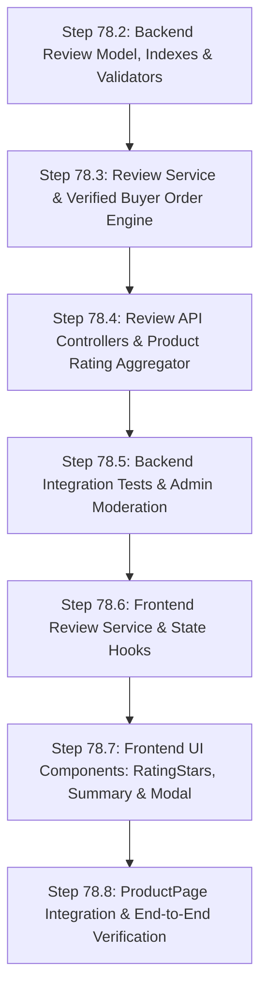

# CommerceFlow Architecture Audit: P1.2 — Customer Reviews & Ratings with Verified-Buyer Enforcement

**Document Version:** 1.0.0<br>
**Phase:** P1.2 — Verified Buyer Reviews & Ratings<br>
**Step:** 78.1 — Architecture Audit Only<br>
**Target Repositories:**
- Backend: `D:\e-commerce\commerceflow-api`
- Frontend: `D:\e-commerce\commerceflow-web`
**Audit Status:** COMPLETE (Read-Only Audit — Zero Code / Schema Changes Applied)

---

## Executive Summary

Customer Reviews and Product Ratings are foundational to consumer confidence in an e-commerce platform. However, unverified reviews, review bombing, duplicate spam, and rating drift represent severe threats to brand credibility and data integrity.

This architecture audit evaluates the exact state of CommerceFlow's backend (`commerceflow-api`) and frontend (`commerceflow-web`) to design a **tamper-proof, verified-buyer review system**. It operates strictly within CommerceFlow's architectural invariants:
- Local standalone MongoDB (no multi-document transactions, no replica sets, no MongoDB Atlas)
- Node.js / Express with Mongoose and Zod
- Pure JavaScript/JSX (no TypeScript)
- In-process consistency patterns (no Redis, Bull, BullMQ, external queues, or background workers)

---

## 1. Current Architecture

### 1.1 Backend Inspection (`commerceflow-api`)

| Module / Component | File Location | Existing Responsibilities & Architecture |
| :--- | :--- | :--- |
| **Product Model** | `src/modules/products/product.model.js` | Schema: `name`, `description`, `price`, `stock`, `category`, `image`, `images`, `specifications`, `isActive`, `restorationKeys`. **No rating or review fields exist** (`ratingAverage`, `ratingCount`, and reviews array are absent). Compound indexes on `(isActive, createdAt)`, `(category, isActive, createdAt)`, `(isActive, price)`. |
| **Product Routes** | `src/modules/products/product.routes.js` | `GET /` (list), `GET /categories`, `POST /` (admin), `GET /:id`, `PATCH /:id` (admin), `DELETE /:id` (admin). ObjectId regex validation: `/^[0-9a-fA-F]{24}$/`. |
| **Product Controller** | `src/modules/products/product.controller.js` | Standard pagination response: `{ success: true, message, data: { products, pagination: { page, limit, totalProducts, totalPages } }, requestId }`. |
| **Order Model** | `src/modules/orders/order.model.js` | Schema contains: `user` (ref User), `items` (subdocuments with `_id: false`: `product`, `name`, `price`, `quantity`, `subtotal`), `pricing` (financial snapshot), `status` (enum), `payment` (subdocument with `status`), `shipment` (subdocument with `status`, `shippedAt`, `deliveredAt`). |
| **Order Status Machine** | `src/modules/orders/update-order-status.controller.js` | Allowed transitions: `pending -> [processing, cancelled]`, `confirmed -> [processing, cancelled]`, `processing -> [shipped, cancelled]`, `shipped -> [delivered]`, `delivered -> []`, `cancelled -> []`. |
| **Order Shipment** | `src/modules/orders/update-shipment.controller.js` | Tracks `carrier`, `trackingNumber`, `status` (`label_created`, `in_transit`, `out_for_delivery`, `delivered`, `exception`), `deliveredAt`. Setting status `delivered` sets `deliveredAt = now`. |
| **Order Cancellation** | `src/modules/orders/cancel-order.controller.js` | Customer can cancel only if `status !== "delivered"` and `status !== "cancelled"`. Atomically increments product stock. Order items remain preserved in MongoDB document. |
| **Auth Middleware** | `src/common/middleware/auth.middleware.js` | Verifies JWT from Bearer header or cookie, sets `req.user` (`_id`, `email`, `role`, `isActive`). |
| **Admin Middleware** | `src/common/middleware/admin.middleware.js` | Enforces `req.user.role === "admin"`. |
| **Error Handling** | `src/common/middleware/error.middleware.js` | Centralized handler converting `AppError` to HTTP responses, Mongoose `11000` to 409 `DUPLICATE_RESOURCE`, `CastError` to 400 `INVALID_ID`, `ValidationError` to 400 `VALIDATION_ERROR`. |
| **Zod Validation** | `src/common/middleware/validate.middleware.js` | Validates `req.body`, `req.query`, and `req.params`. Strips/rejects unexpected fields. |

### 1.2 Frontend Inspection (`commerceflow-web`)

| Component / Page | File Location | Existing State & Review Traces |
| :--- | :--- | :--- |
| **Product Details** | `src/pages/ProductPage.jsx` | Contains a **hardcoded static placeholder** at lines 337–348: 5 SVG orange stars, fixed text `"5.0"`, and badge `"(Verified Gear)"`. No live API connection for reviews exists. No review list, rating breakdown, or review submission form exists. |
| **Product Card** | `src/components/ProductCard.jsx` | Renders thumbnail, category, name, price, stock badges, wishlist button, and add-to-cart. Displays no rating stars or review counts. |
| **Orders** | `src/pages/OrderDetailsPage.jsx` | Displays order status, item list, shipment tracking, payment status. No "Write a Review" button or link back to product review forms. |
| **Reviews / Ratings** | Anywhere in `src/` | Grep analysis for `review`, `rating`, `star`, `testimonial`, `feedback` shows **zero review modules, services, or contexts**. Only static visual tokens exist. |

---

## 2. Current Order Purchase Evidence

Proving that **User A purchased Product B** is the core invariant of the Verified Buyer system.

### 2.1 Explicit Audit Questions & Findings

1. **Which order statuses currently exist?**
   - In `order.model.js`: `["pending", "confirmed", "processing", "shipped", "delivered", "cancelled"]`.
2. **Which payment states currently exist?**
   - In `order.model.js` (`paymentSchema`): `["pending", "paid", "failed", "refunded"]`.
3. **Is there a reliable delivered state?**
   - Yes, two complementary fields exist:
     - `order.status === "delivered"`: Set by admin via `PATCH /api/v1/orders/:orderId/status`. In the state machine, `delivered` is a terminal state with no outgoing transitions (`ALLOWED_TRANSITIONS.delivered = []`).
     - `order.shipment.status === "delivered"`: Set by admin via `PUT /api/v1/orders/:orderId/shipment`. Automatically timestamps `deliveredAt`.
4. **Can a cancelled order still contain the product?**
   - Yes. When an order is cancelled (by customer in `cancel-order.controller.js` or admin in `update-order-status.controller.js`), `order.items` is **never emptied**. The historical items and product references remain in the MongoDB document.
5. **Can an order be cancelled after payment?**
   - Yes. If an order is paid (`payment.status === "paid"`), but fulfillment is still in `pending`, `confirmed`, or `processing`, the customer or admin can cancel it.
6. **Is refund handling implemented?**
   - The schema defines `status: "refunded"`, but automated payment gateway refund processing (via Razorpay API) is **not implemented** in the cancellation controllers. When cancelled, `payment.status` remains `"paid"` unless manually updated by an admin.
7. **Is shipment delivery already tracked?**
   - Yes, via the `order.shipment` subdocument (`carrier`, `trackingNumber`, `trackingUrl`, `status`, `shippedAt`, `estimatedDelivery`, `deliveredAt`).
8. **Does shipment status have `delivered`?**
   - Yes, the shipment status enum explicitly includes `"delivered"`.
9. **Which state is the safest basis for "verified buyer" under the current architecture?**
   - **Terminal Delivered State (`order.status === "delivered"` OR `order.shipment.status === "delivered"`) with `order.payment.status === "paid"` and `order.status !== "cancelled"`.**
   - **Rationale:** A customer cannot evaluate or review physical gear (quality, fit, performance, durability) before holding the item. Furthermore, once an order reaches `delivered`, CommerceFlow's cancellation state machine strictly prohibits cancellation (`order.status === "delivered"` cannot transition to `"cancelled"`).
10. **If the current architecture cannot prove delivery/refund state reliably, what is the safest currently-supported verification rule?**
    - Under the current system, delivery is fully modeled in both `order.status` and `order.shipment.status`. If a store environment allows reviews upon confirmed payment prior to delivery (e.g. digital goods or delayed courier tracking), the minimum verification rule is `order.payment.status === "paid" AND order.status !== "cancelled"`. However, for physical e-commerce equipment, **`order.status === "delivered"` is the gold standard and the safest invariant**.

---

## 3. Review Data Model Decision

### 3.1 Architectural Comparison

| Architecture | Evaluation | Recommendation |
| :--- | :--- | :--- |
| **A. Embedded inside `Product`** | **Disqualified.** Violates MongoDB 16MB document size limit for high-volume products; causes write-lock contention on hot product documents during read traffic; makes review pagination, moderation, and sorting prohibitively slow. | REJECT |
| **B. Embedded inside `OrderItem`** | **Disqualified.** Orders are immutable financial snapshots (`_id: false` on items). Querying reviews across all orders to render a product page requires collection-wide `$unwind` scans over orders. | REJECT |
| **C. Dedicated `Review` Collection** | **Recommended.** Clean separation of concerns; independent pagination, indexing, and sorting; non-blocking writes; straightforward moderation and aggregation. | **ADOPT** |

### 3.2 Recommended Schema (`commerceflow-api/src/modules/reviews/review.model.js`)

```javascript
const reviewSchema = new mongoose.Schema(
  {
    product: {
      type: mongoose.Schema.Types.ObjectId,
      ref: "Product",
      required: [true, "Product reference is required"],
      index: true
    },
    user: {
      type: mongoose.Schema.Types.ObjectId,
      ref: "User",
      required: [true, "User reference is required"],
      index: true
    },
    order: {
      type: mongoose.Schema.Types.ObjectId,
      ref: "Order",
      required: [true, "Order reference is required"]
    },
    rating: {
      type: Number,
      required: [true, "Rating is required"],
      min: [1, "Rating must be at least 1"],
      max: [5, "Rating cannot exceed 5"],
      validate: {
        validator: Number.isInteger,
        message: "Rating must be an integer between 1 and 5"
      }
    },
    title: {
      type: String,
      trim: true,
      maxlength: [100, "Review title cannot exceed 100 characters"],
      default: ""
    },
    body: {
      type: String,
      required: [true, "Review body is required"],
      trim: true,
      minlength: [5, "Review body must be at least 5 characters"],
      maxlength: [2000, "Review body cannot exceed 2000 characters"]
    },
    isVerifiedBuyer: {
      type: Boolean,
      default: true,
      immutable: true // Server-assigned only; clients cannot tamper
    },
    status: {
      type: String,
      enum: ["published", "hidden", "flagged"],
      default: "published",
      index: true
    }
  },
  {
    timestamps: true
  }
);

// Compound Unique Index: One review per user per product
reviewSchema.index({ user: 1, product: 1 }, { unique: true });

// Compound Query Index: Efficient product review listings
reviewSchema.index({ product: 1, status: 1, createdAt: -1 });
reviewSchema.index({ product: 1, status: 1, rating: -1 });
```

### 3.3 Explicit Design Decisions

- **Rating Range:** Integer `1` to `5` (half-stars add client/input complexity without significant informational gain).
- **Title:** Optional (or max 100 characters); customers shouldn't be blocked if they just want to provide quick feedback.
- **Body:** Required, minimum 5 characters, maximum 2,000 characters (prevents empty spam and database bloat).
- **Anonymous Reviews:** **Strictly prohibited.** Every review must be tied to an authenticated `user` ObjectId. Public API will only display author's display name or masked name (`John D.`) for privacy.
- **Order Reference:** Required field. Records the specific qualifying order that granted review eligibility.
- **Order Item Reference:** Not tied to individual order item IDs because `order.items` subdocuments in CommerceFlow have `_id: false`. Linking to `order` is unambiguous and sufficient.
- **Review Deletion Policy:** Hard-delete for user deletion (or soft status `"hidden"` for admin moderation). When deleted by the author, the user may subsequently write a new review if desired.
- **Edit Policy:** Author can update `rating`, `title`, and `body`. Updates automatically set `updatedAt`. If edited, `isVerifiedBuyer` remains intact.

---

## 4. Verified-Buyer Rule

### 4.1 Invariant Architecture

The client/frontend must **never** be trusted. A client request claiming `"isVerifiedBuyer": true` or submitting an arbitrary `orderId` must never be taken at face value.

### 4.2 Auto-Discovery vs. Explicit Order ID

| Approach | Description | Tradeoffs & Security Analysis | Recommendation |
| :--- | :--- | :--- | :--- |
| **Approach 1: Client submits `orderId`** | `POST /api/v1/products/:productId/reviews` with `{ orderId, rating, ... }` | **Poor UX & High Complexity.** Customer must find and copy their Order ID to write a review on a product page. High risk of IDOR or user guessing invalid IDs. | REJECT as primary |
| **Approach 2: Server Auto-Discovery** | `POST /api/v1/products/:productId/reviews` with `{ rating, title, body }` | **Superior UX & Zero Client Trust.** Backend automatically queries database for qualifying purchase by `req.user._id` for `productId`. Impossible for client to tamper. | **ADOPT (Primary)** |

*Note on Hybrid Flexibility:* The server can optionally accept an `orderId` if submitted from an Order Details page ("Review this item" link), but the backend must validate that exact order against the same strict qualification criteria.

### 4.3 Server-Side Qualification Query

To verify purchase eligibility, the backend executes the following atomic lookup:

```javascript
const qualifyingOrder = await Order.findOne({
  user: req.user._id,
  "items.product": productId,
  status: { $in: ["delivered"] }, // Or ["delivered", "shipped"] based on policy
  "payment.status": "paid"
}).sort({ createdAt: -1 });

if (!qualifyingOrder) {
  throw new AppError(
    "Only verified buyers who have received this product may leave a review",
    403,
    [],
    "REVIEW_NOT_ELIGIBLE"
  );
}
```

---

## 5. Duplicate Review Policy

### 5.1 Evaluated Options

- **Option A: One review per user per product (`unique(user, product)`)**<br>
  *Pros:* A customer evaluates the product itself. If a user buys the same tent twice, they shouldn't submit two identical 5-star reviews to inflate the score. If their experience changed, they should update their existing review.<br>
  *Cons:* Cannot post a second review for a separate order.
- **Option B: One review per user per order per product (`unique(user, order, product)`)**<br>
  *Pros:* Allows distinct reviews for repeat purchases over time.<br>
  *Cons:* Vulnerable to artificial rating inflation by repeat small purchases; creates cluttered UI on product pages.
- **Option C: One review per order item**<br>
  *Cons:* Irrelevant; order items do not have unique IDs in CommerceFlow.

### 5.2 Recommendation: Option A (`unique: { user: 1, product: 1 }`)

- Enforced by a **MongoDB unique compound index**:
  ```javascript
  reviewSchema.index({ user: 1, product: 1 }, { unique: true });
  ```
- **Race Condition Immunity:** If two concurrent requests arrive simultaneously from the same user, MongoDB's unique index constraint ensures exactly one succeeds and the other fails with E11000 duplicate key error, which CommerceFlow's `error.middleware.js` automatically maps to HTTP 409 `DUPLICATE_RESOURCE` (or custom `REVIEW_ALREADY_EXISTS`).

---

## 6. Rating Aggregation Strategy

CommerceFlow operates on **standalone MongoDB without replica sets or multi-document transactions**, and without Redis or background workers.

### 6.1 Evaluation of Aggregation Approaches

| Approach | Mechanics | Tradeoffs | Production Suitability |
| :--- | :--- | :--- | :--- |
| **Option A: Dynamic Aggregation** | Compute on-demand via `Review.aggregate()` when fetching reviews or product page. | Guaranteed 100% mathematical consistency. Zero counter drift. Never affected by transaction crashes or concurrent edits. | **Excellent for Product Details & Reviews.** Slower if executed for every item in a 100-item catalog list. |
| **Option B: Persisted Counters on `Product`** | Store `ratingAverage` and `ratingCount` on `Product`. Incremented/decremented on review events. | Fast reads. However, without transactions, server crashes during review creation or concurrent writes cause **permanent counter drift**. | **Risky without two-phase commit or background reconciliation.** |
| **Option C: Hybrid (Recalculate & Persist)** | On review mutation (create/update/delete), run a pipeline aggregation and `$set` the aggregated `{ ratingAverage, ratingCount }` atomically onto `Product`. | Combines speed for product cards with authoritative aggregation. Even if an update fails, it is an idempotent `$set`, not an accumulating `$inc`. | **RECOMMENDED FOR PRODUCTION** |

### 6.2 Recommended Aggregation Pipeline

```javascript
async function recalculateProductRating(productId) {
  const [stats] = await Review.aggregate([
    {
      $match: {
        product: new mongoose.Types.ObjectId(productId),
        status: "published"
      }
    },
    {
      $group: {
        _id: "$product",
        ratingCount: { $sum: 1 },
        ratingAverage: { $avg: "$rating" }
      }
    }
  ]);

  const ratingCount = stats ? stats.ratingCount : 0;
  const ratingAverage = stats ? Math.round(stats.ratingAverage * 10) / 10 : 0;

  await Product.findByIdAndUpdate(productId, {
    $set: {
      ratingAverage,
      ratingCount
    }
  });

  return { ratingAverage, ratingCount };
}
```

*Key Benefit:* Because it uses `$set` rather than `$inc`, any concurrent or retried recalculation is idempotent and self-healing.

---

## 7. Review Moderation Strategy

To maintain a clean, production-ready platform without unnecessary third-party services:
- **Default State:** `"published"` (immediate visibility upon submission by verified buyers).
- **Moderation States:** `status: ["published", "hidden", "flagged"]`.
- **Admin Capability:** Admin can toggle any review to `"hidden"` (violates policy, abusive, spam) via `PATCH /api/v1/admin/reviews/:reviewId/status`.
- **Customer Filter:** Public `GET /api/v1/products/:productId/reviews` queries strictly `{ status: "published" }`.
- **Author Transparency:** If an author queries their own review, they can see its status even if flagged.

---

## 8. Review API Design

### 8.1 Proposed Endpoints

#### 1. Public Review List
- **Route:** `GET /api/v1/products/:productId/reviews`
- **Auth:** Public (Guest / Customer / Admin)
- **Query Params:**
  - `page`: Integer (min: 1, default: 1)
  - `limit`: Integer (min: 1, max: 50, default: 10)
  - `rating`: Integer (1-5, optional filter)
  - `sortBy`: Enum `["createdAt", "rating"]` (default: `"createdAt"`)
  - `sortOrder`: Enum `["asc", "desc"]` (default: `"desc"`)
- **Response Shape:**
  ```json
  {
    "success": true,
    "message": "Reviews retrieved successfully",
    "data": {
      "reviews": [
        {
          "_id": "67...",
          "rating": 5,
          "title": "Rugged and durable",
          "body": "Tested this tent on a 3-day trek...",
          "isVerifiedBuyer": true,
          "createdAt": "2026-09-30T...",
          "user": {
            "_id": "67...",
            "name": "Alex D."
          }
        }
      ],
      "summary": {
        "ratingAverage": 4.8,
        "ratingCount": 12,
        "distribution": { "5": 10, "4": 2, "3": 0, "2": 0, "1": 0 }
      },
      "pagination": {
        "page": 1,
        "limit": 10,
        "totalReviews": 12,
        "totalPages": 2
      }
    },
    "requestId": "req-..."
  }
  ```

#### 2. Review Eligibility Check
- **Route:** `GET /api/v1/products/:productId/reviews/eligibility`
- **Auth:** Required (`authMiddleware`)
- **Response Shape:**
  ```json
  {
    "success": true,
    "message": "Eligibility verified",
    "data": {
      "isEligible": true,
      "hasReviewed": false,
      "existingReview": null,
      "qualifyingOrderId": "67..."
    },
    "requestId": "req-..."
  }
  ```

#### 3. Create Review
- **Route:** `POST /api/v1/products/:productId/reviews`
- **Auth:** Required (`authMiddleware`)
- **Body:**
  ```json
  {
    "rating": 5,
    "title": "Great quality!",
    "body": "Held up in heavy rainfall without any leaks."
  }
  ```
- **Validation (Zod):**
  - `rating`: `z.number().int().min(1).max(5)`
  - `title`: `z.string().trim().max(100).optional()`
  - `body`: `z.string().trim().min(5).max(2000)`

#### 4. Update Review
- **Route:** `PATCH /api/v1/reviews/:reviewId`
- **Auth:** Required (`authMiddleware`)
- **Authorization:** Author only (`review.user.equals(req.user._id)`)
- **Body:** `{ rating?, title?, body? }`

#### 5. Delete Review
- **Route:** `DELETE /api/v1/reviews/:reviewId`
- **Auth:** Required (`authMiddleware`)
- **Authorization:** Author OR Admin

#### 6. Admin Moderate Review Status
- **Route:** `PATCH /api/v1/admin/reviews/:reviewId/status`
- **Auth:** Required (`authMiddleware` + `adminMiddleware`)
- **Body:** `{ "status": "published" | "hidden" | "flagged" }`

---

## 9. Review List Requirements (P1.2 Scope)

For P1.2, the review listing must provide:
1. Pagination (`page`, `limit`).
2. Newest-first sorting (`sortBy=createdAt&sortOrder=desc`).
3. Rating filter (e.g. view only 5-star or 1-star reviews).
4. Author name masking (`Alex D.`) to comply with user privacy standards.
5. Overall summary: Average rating, total count, and distribution breakdown (5 to 1 stars).
6. Filtering to show only `status: "published"`.

---

## 10. Product API Compatibility

To preserve existing API contracts:
- `Product` documents in MongoDB will eventually include:
  ```javascript
  ratingAverage: { type: Number, default: 0, min: 0, max: 5 },
  ratingCount: { type: Number, default: 0, min: 0 }
  ```
- All existing endpoints (`GET /api/v1/products`, `GET /api/v1/products/:id`) will naturally include `ratingAverage` and `ratingCount` without breaking frontend consumers.
- Product listings and product cards will display real rating stars and review counts seamlessly.

---

## 11. Frontend Architecture (`commerceflow-web`)

### 11.1 Directory Structure
```text
src/features/reviews/
├── review.service.js       # API calls (getReviews, checkEligibility, createReview, updateReview, deleteReview)
├── useReviews.js           # Custom hook for review list fetching, pagination, and rating filtering
├── useReviewEligibility.js # Custom hook for authenticated user eligibility check
└── components/
    ├── RatingStars.jsx     # Reusable star rating visualizer (supports read-only and interactive input)
    ├── RatingSummary.jsx   # Visual bar breakdown (5-star to 1-star distribution and average)
    ├── ReviewCard.jsx      # Individual review item with verified badge, author, date, and actions
    ├── ReviewFormModal.jsx # Accessible modal dialog for writing / editing reviews
    └── ReviewSection.jsx   # Integrated tab/section in ProductPage
```

### 11.2 UX Workflow on `ProductPage.jsx`
1. **Header Rating Eyebrow:** Replace static `5.0 (Verified Gear)` with live `<RatingStars rating={product.ratingAverage} count={product.ratingCount} />`.
2. **Review Section (Bottom of Product Page):**
   - Left side: Rating summary score, visual star histogram.
   - Right side / Action bar:
     - **Guest:** Button `"Sign in to review"` -> redirects to `/login?redirect=/products/:id`.
     - **Eligible Buyer (Not Yet Reviewed):** Button `"Write a Review"` -> opens `ReviewFormModal`.
     - **Buyer Has Already Reviewed:** Badge `"You reviewed this on [date]"` + buttons to `"Edit"` or `"Delete"`.
     - **Customer Not Eligible:** Subtle helper text: *"Purchased this item? Reviews become available once your order is delivered."*
3. **Product Card:**
   - Display subtle rating snippet: `★ 4.8 (24)` below title.

---

## 12. Guest Behavior

- Guests can read all published reviews and view rating summaries.
- Guests cannot submit reviews, edit reviews, delete reviews, or claim verified status.
- Clicking `"Write a Review"` while unauthenticated redirects to:
  ```text
  /login?redirect=/products/${productId}
  ```
  After successful login, the user returns directly to the product page.

---

## 13. Security Audit & Attack Vectors

| Threat Vector | Severity | Mitigation in Architecture |
| :--- | :--- | :--- |
| **IDOR on Review Creation** | CRITICAL | The `user` reference is **never** accepted from `req.body`. It is strictly extracted from verified JWT `req.user._id`. |
| **Fake Verified Buyer Claims** | CRITICAL | `isVerifiedBuyer` is strictly server-assigned. The backend verifies a matching `Order` with `status: "delivered"` containing the product. |
| **Tampered Order Reference** | HIGH | Backend verifies `order.user.equals(req.user._id)` and verifies `order.items.product` contains `productId`. |
| **Review Hijacking (Edit/Delete)** | HIGH | Ownership is strictly checked: `review.user.toString() === req.user._id.toString()`. Unauthorized attempts yield `403 REVIEW_ACCESS_DENIED`. |
| **XSS via Review Body/Title** | HIGH | All titles and bodies are treated as untrusted plain text. React escapes all JSX children by default. `dangerouslySetInnerHTML` is prohibited. Zod strips control characters. |
| **Review Bombing / Spam Race** | HIGH | MongoDB unique compound index `{ user: 1, product: 1 }` prevents concurrent parallel submissions from creating duplicate reviews. |
| **Payload Bloat Denial of Service**| MEDIUM | Zod enforces `maxlength: 100` on title and `maxlength: 2000` on body. Central body-parser enforces 100kb limit. |
| **Unpublished / Hidden Leaks** | MEDIUM | Public endpoints query strictly `status: "published"`. Admin moderation status changes are audited. |

---

## 14. MongoDB Standalone Constraints

CommerceFlow runs on standalone local MongoDB. The following rules govern our architecture:
1. **No Multi-Document Transactions:** Invariant enforcement must rely on **atomic single-document operations** (`findOneAndUpdate`, `findByIdAndUpdate`) and **database indexes** (`unique: true`).
2. **Crash-Safe Aggregations:** Recalculation of rating summaries uses authoritative `$set` updates rather than incremental `$inc` delta operations. If the application crashes midway, subsequent operations or recalculations automatically heal the state.
3. **Unique Index Source of Truth:** Duplicate prevention is strictly anchored in MongoDB's B-Tree unique index constraint, not application-level memory checks.

---

## 15. Required Indexes

```javascript
// 1. Enforce unique review per user per product
Review.collection.createIndex({ user: 1, product: 1 }, { unique: true });

// 2. Querying published reviews for a product sorted by date
Review.collection.createIndex({ product: 1, status: 1, createdAt: -1 });

// 3. Querying published reviews for a product sorted by rating
Review.collection.createIndex({ product: 1, status: 1, rating: -1 });

// 4. Aggregating ratings for a product
Review.collection.createIndex({ product: 1, status: 1, rating: 1 });

// 5. User looking up their own reviews
Review.collection.createIndex({ user: 1, createdAt: -1 });
```

---

## 16. Error Contract

All errors use CommerceFlow's established `AppError` format:

```json
{
  "success": false,
  "error": {
    "code": "ERROR_CODE",
    "message": "Human-readable explanation",
    "details": []
  },
  "requestId": "req-..."
}
```

| HTTP Status | Error Code | Trigger Condition |
| :--- | :--- | :--- |
| **400** | `VALIDATION_ERROR` | Rating < 1 or > 5, title > 100 chars, body < 5 chars, invalid ObjectId format. |
| **401** | `UNAUTHORIZED` | Unauthenticated user attempting to create, edit, or delete a review. |
| **403** | `REVIEW_NOT_ELIGIBLE` | Authenticated user has not purchased and received the product. |
| **403** | `REVIEW_ACCESS_DENIED` | User attempting to edit or delete another user's review. |
| **404** | `PRODUCT_NOT_FOUND` | Product ID does not exist or product is inactive. |
| **404** | `REVIEW_NOT_FOUND` | Target review ID does not exist. |
| **409** | `REVIEW_ALREADY_EXISTS` | User has already submitted a review for this product. |

---

## 17. Testing Strategy Matrix

### Backend Unit & Integration Tests (`src/modules/reviews/`)
1. **Authentication & Authorization:**
   - Guest `POST /reviews` returns 401.
   - Non-owner `PATCH /reviews/:id` returns 403.
   - Non-owner `DELETE /reviews/:id` returns 403.
   - Admin `DELETE /reviews/:id` succeeds.
2. **Verified Buyer Rules:**
   - User with qualifying `delivered` order succeeds.
   - User with non-delivered order (`processing`, `shipped`) returns 403 `REVIEW_NOT_ELIGIBLE`.
   - User with cancelled order returns 403 `REVIEW_NOT_ELIGIBLE`.
   - User with order that does not contain target product returns 403.
   - User with unpaid order returns 403.
3. **Duplicate Protection:**
   - Second review attempt returns 409 `REVIEW_ALREADY_EXISTS`.
   - Concurrent parallel `POST` requests fail gracefully on unique index.
4. **Validation:**
   - Rating 0 or 6 rejected.
   - Body less than 5 characters rejected.
   - Body > 2000 characters rejected.
5. **Aggregation Accuracy:**
   - Creating 5-star and 4-star reviews calculates `ratingAverage: 4.5`, `ratingCount: 2`.
   - Deleting a review updates `Product` ratingAverage and ratingCount accurately.
   - Editing a rating recalculates summary accurately.

### Frontend Component & Integration Tests (`commerceflow-web`)
1. Guest view displays review list and rating summary.
2. "Write a Review" button hidden or prompts login for guests.
3. Ineligible buyer sees verified-buyer requirement message.
4. Verified buyer can open modal, submit review, and see immediate optimistic or updated list.
5. Form validation displays accessible error alerts.
6. Rating filter buttons filter the review list correctly.

---

## 18. Product Lifecycle Edge Cases

1. **Product becomes inactive (`isActive: false`):**
   - Existing reviews remain in database. Public product page returns 404, so reviews are inaccessible to customers. Admin can still inspect reviews.
2. **Product is deleted:**
   - Reviews should be cascaded or orphaned reviews excluded by `Review.deleteMany({ product: productId })`.
3. **Order is cancelled after submission:**
   - Not possible once `delivered`, because CommerceFlow's state machine blocks cancelling delivered orders (`ALLOWED_TRANSITIONS.delivered = []`).
4. **User deletes their review:**
   - Review document is removed from MongoDB.
   - `recalculateProductRating(productId)` runs immediately, updating `Product.ratingAverage` and `Product.ratingCount`.
   - User becomes eligible to write a new review in the future.
5. **Admin hides a review (`status: "hidden"`):**
   - Review is excluded from public `GET /reviews`.
   - `recalculateProductRating` excludes non-published reviews from average and count.
6. **User repurchases the same product:**
   - Since uniqueness is `(user, product)`, the user does not create a duplicate review; they are presented with their existing review and can update it.

---

## 19. Scope Boundary

### Included in P1.2 Scope
- Dedicated `Review` collection and model with indexes.
- Verified-buyer enforcement linking to delivered, paid orders.
- One review per user per product (`unique: { user, product }`).
- Authoritative rating aggregation on `Product` (`ratingAverage`, `ratingCount`).
- CRUD APIs for customer reviews + Admin moderation status toggle.
- Comprehensive Zod validation and error contracts.
- Frontend review list, rating breakdown, verified badge, and review submission/edit modal on `ProductPage.jsx`.
- Full backend and frontend test suites.

### Excluded / Future Enhancements
- Photo and video review attachments.
- Helpful / Unhelpful voting buttons.
- Merchant / Seller responses to reviews.
- Automated sentiment analysis.
- Verified buyer badges beyond purchase history (e.g. "Top Reviewer").
- Email review request triggers post-delivery.

---

## 20. Implementation Sequence for Step 78.2 Onward

The feature will be implemented in strict accordance with CommerceFlow's incremental safety rules:



1. **Step 78.2 — Review Data Model & Zod Validation:**
   - Create `src/modules/reviews/review.model.js` with compound indexes.
   - Create `src/modules/reviews/review.validator.js` for create, update, and query schemas.
   - Unit tests for schema validation.
2. **Step 78.3 — Verified-Buyer Verification Engine & Service:**
   - Implement purchase qualification lookup in `src/modules/reviews/review.service.js`.
   - Implement rating recalculation helper.
3. **Step 78.4 — Backend API Routes & Controllers:**
   - Implement `createReview`, `getReviews`, `updateReview`, `deleteReview`, and `checkEligibility`.
   - Mount routes at `/api/v1/products/:productId/reviews` and `/api/v1/reviews`.
4. **Step 78.5 — Backend Integration Test Suite:**
   - Comprehensive test suite covering verified buyer, duplicate rejection, ownership, and aggregation.
5. **Step 78.6 — Frontend Review API Client & Hooks:**
   - Create `src/features/reviews/review.service.js` and `useReviews.js`.
6. **Step 78.7 — Frontend UI Components & Modal:**
   - Build `RatingStars.jsx`, `RatingSummary.jsx`, `ReviewCard.jsx`, `ReviewFormModal.jsx`.
7. **Step 78.8 — Integration & Final Verification:**
   - Connect reviews to `ProductPage.jsx` and display ratings on `ProductCard.jsx`.
   - Full regression test run across backend and frontend.

---

*Audit completed by Staff/Principal Backend Engineer — CommerceFlow Project.*
