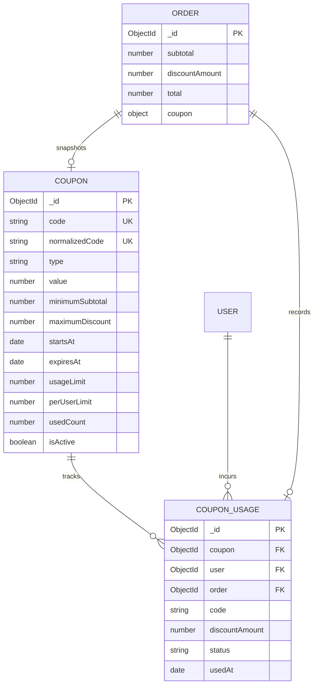

# CommerceFlow — P1.1 Step 77.1: Coupon & Discount Architecture Audit

**Status:** ARCHITECTURE SPECIFICATION (READ-ONLY AUDIT)<br>
**Date:** September 30, 2026<br>
**Auditor:** Antigravity AI Backend & Systems Engineering Pair<br>
**Target Milestone:** P1.1 — Customer Coupons & Discounts<br>
**Repository Context:** `commerceflow-api` (Express ESM + Mongoose) & `commerceflow-web` (React 19 + Vite)

---

## 1. Audit Current Pricing Architecture

### Existing Financial Contract
In the current production codebase, order financials are calculated server-side in `commerceflow-api/src/utils/pricing.js` via `calculateOrderFinancials(subtotal, options)`.

The financial contract defines five core fields persisted on the `Order` model (`commerceflow-api/src/modules/orders/order.model.js`):

| Field | Type | Constraint | Default | Source of Truth |
| :--- | :--- | :--- | :--- | :--- |
| `subtotal` | Number | `required: true, min: 0` | N/A | Server-calculated sum of line items: `item.price * item.quantity` |
| `shippingAmount` | Number | `required: true, min: 0` | `0` | Server-calculated (currently 0 in initial phase) |
| `taxAmount` | Number | `required: true, min: 0` | `0` | Server-calculated (currently 0 in initial phase) |
| `discountAmount` | Number | `required: true, min: 0` | `0` | Server-calculated (currently 0 prior to P1.1) |
| `total` | Number | `required: true, min: 0` | `0` | Server-authoritative: `Math.max(0, subtotal + shippingAmount + taxAmount - discountAmount)` |

### Persisted Location & Calculation Pipeline
1. **Catalog Price Integrity:** At order placement (`commerceflow-api/src/modules/orders/order.controller.js`), the client passes ONLY `{ addressId }`. Item prices and names are queried directly from active MongoDB documents:
   ```javascript
   const product = await Product.findOne({ _id: cartItem.product._id, isActive: true });
   ```
2. **Line Item Snapshots:** Product price and name are permanently snapshotted into `order.items`:
   ```javascript
   orderItems.push({
     product: product._id,
     name: product.name,
     price: product.price,
     quantity: cartItem.quantity,
     subtotal: product.price * cartItem.quantity
   });
   ```
3. **Financial Invariant:** `pricing.js` guarantees:
   $$\text{total} = \max(0, \text{subtotal} + \text{shippingAmount} + \text{taxAmount} - \text{discountAmount})$$
4. **Payment Gateway Binding:** When Razorpay payment is initiated (`create-payment-order.controller.js`), the payable amount is derived solely from the database order:
   ```javascript
   const payableAmount = getOrderPayableAmount(order);
   const amountInPaise = toPaise(payableAmount);
   ```
5. **Client Authority Prohibition:** The frontend (`commerceflow-web`) has zero authority over financial values. `normalizeOrderFinancials(order)` in `src/lib/utils.js` treats backend amounts as read-only display values. The client cannot set or manipulate subtotal, shipping, tax, discount, total, or Razorpay amount.

---

## 2. Recommended Coupon Architecture

### Infrastructure Realities
* **Local Standalone MongoDB:** The database runs as a standalone daemon on `mongodb://127.0.0.1:27017/commerceflow`.
* **No Multi-Document Transactions:** Standalone MongoDB does not support replica set ACID transactions without infrastructure reconfiguration.
* **Concurrency Primitive:** Concurrency safety must rely on single-document atomic updates (`findOneAndUpdate`, `$inc`, `$set`) and database-level unique indexes.

### Recommended Dual-Collection Architecture
We recommend two dedicated collections:
1. `Coupon`: Stores master coupon definitions, rules, discount rates, eligibility windows, and global usage counters.
2. `CouponUsage`: Records immutable usage events linking customer, coupon, and order.



### Architectural Rationale
1. **Unbounded Document Growth Prevention:** Storing an array of user IDs inside the `Coupon` document violates MongoDB best practices (16MB document limit and document reallocation penalties).
2. **Audit & Regulatory Compliance:** `CouponUsage` provides an indelible audit record of who redeemed which discount on which order and when.
3. **Idempotency & Concurrency:** A unique compound index on `CouponUsage` (`{ coupon: 1, user: 1, order: 1 }` or `{ order: 1 }`) physically prevents double redemption at the database engine level.

---

## 3. Coupon Model Specification

### Proposed Schema (`src/modules/coupons/coupon.model.js`)

```javascript
import mongoose from "mongoose";

const couponSchema = new mongoose.Schema(
  {
    code: {
      type: String,
      required: true,
      trim: true,
      minlength: 3,
      maxlength: 20
    },

    normalizedCode: {
      type: String,
      required: true,
      trim: true,
      uppercase: true,
      unique: true,
      index: true
    },

    description: {
      type: String,
      trim: true,
      maxlength: 200,
      default: ""
    },

    type: {
      type: String,
      enum: ["percentage", "fixed"],
      required: true
    },

    value: {
      type: Number,
      required: true,
      min: 1
    },

    minimumSubtotal: {
      type: Number,
      required: true,
      min: 0,
      default: 0
    },

    maximumDiscount: {
      type: Number,
      default: null,
      min: 1
    },

    startsAt: {
      type: Date,
      default: null
    },

    expiresAt: {
      type: Date,
      default: null
    },

    usageLimit: {
      type: Number,
      default: null,
      min: 1
    },

    perUserLimit: {
      type: Number,
      required: true,
      min: 1,
      default: 1
    },

    usedCount: {
      type: Number,
      required: true,
      default: 0,
      min: 0
    },

    isActive: {
      type: Boolean,
      required: true,
      default: true
    },

    applicableProducts: {
      type: [mongoose.Schema.Types.ObjectId],
      ref: "Product",
      default: []
    },

    applicableCategories: {
      type: [String],
      default: []
    }
  },
  {
    timestamps: true
  }
);

couponSchema.index({ normalizedCode: 1 }, { unique: true });
couponSchema.index({ isActive: 1, expiresAt: 1 });

const Coupon = mongoose.model("Coupon", couponSchema);
export default Coupon;
```

### Field-by-Field Analysis

| Field | Type & Validation | Purpose | Index Requirement | Security & Business Impact |
| :--- | :--- | :--- | :--- | :--- |
| `code` | String, 3–20 chars | Display representation of promo code | None (display only) | Preserves casing for marketing. |
| `normalizedCode` | String, uppercase, trimmed | Primary lookup key | **Unique Index** | Prevents duplicate coupons with different casing (`SUMMER10` vs `summer10`). |
| `type` | Enum: `percentage`, `fixed` | Discount calculation rule | None | Restricts math to verified financial paths. |
| `value` | Number, min: 1 | Percentage off (1–100) or flat INR amount | None | Validated by Zod (percentage capped at 100). |
| `minimumSubtotal` | Number, min: 0 | Basket hurdle threshold | None | Prevents discount abuse on trivial item purchases. |
| `maximumDiscount` | Number, optional | Upper bound for percentage discounts | None | Prevents catastrophic losses on large cart orders. |
| `startsAt` | Date, optional | Campaign launch date | Composite with `isActive` | Disallows redemption before promo window opens. |
| `expiresAt` | Date, optional | Campaign end date | Composite with `isActive` | Disallows redemption after promo window closes. |
| `usageLimit` | Number, optional | Total redemptions across all users | None | Hard budget cap on campaign redemptions. |
| `perUserLimit` | Number, default: 1 | Max redemptions per customer account | None | Prevents single-user coupon exploitation. |
| `usedCount` | Number, default: 0 | Real-time global usage counter | None | Atomically incremented via `$inc`. |
| `isActive` | Boolean, default: true | Kill switch | Composite Index | Instant administrative deactivation. |
| `applicableProducts`| Array of ObjectIds | Restrict to specific gear | None | Empty array indicates store-wide validity. |
| `applicableCategories`| Array of Strings | Restrict to gear category (Camping, etc.) | None | Empty array indicates all categories valid. |

---

## 4. Coupon Usage Model Specification

### Proposed Schema (`src/modules/coupons/coupon-usage.model.js`)

```javascript
import mongoose from "mongoose";

const couponUsageSchema = new mongoose.Schema(
  {
    coupon: {
      type: mongoose.Schema.Types.ObjectId,
      ref: "Coupon",
      required: true,
      index: true
    },

    user: {
      type: mongoose.Schema.Types.ObjectId,
      ref: "User",
      required: true,
      index: true
    },

    order: {
      type: mongoose.Schema.Types.ObjectId,
      ref: "Order",
      required: true,
      index: true
    },

    code: {
      type: String,
      required: true,
      trim: true
    },

    discountAmount: {
      type: Number,
      required: true,
      min: 0
    },

    status: {
      type: String,
      enum: ["reserved", "consumed", "cancelled"],
      default: "consumed",
      required: true
    },

    usedAt: {
      type: Date,
      default: Date.now,
      required: true
    }
  },
  {
    timestamps: true
  }
);

// Enforce single coupon redemption per order
couponUsageSchema.index({ order: 1 }, { unique: true });

// Optimize query for per-user redemption limit checks
couponUsageSchema.index({ coupon: 1, user: 1, status: 1 });

const CouponUsage = mongoose.model("CouponUsage", couponUsageSchema);
export default CouponUsage;
```

### Concurrency & Limit Enforcement Without Transactions
1. **Per-User Limit Enforcement:**
   When evaluating a coupon for `userId`:
   ```javascript
   const userUsageCount = await CouponUsage.countDocuments({
     coupon: coupon._id,
     user: userId,
     status: { $ne: "cancelled" }
   });
   if (userUsageCount >= coupon.perUserLimit) {
     throw new AppError("Coupon usage limit reached for this account", 400, [], "COUPON_USER_LIMIT_EXCEEDED");
   }
   ```
2. **Order Idempotency:** The unique index `{ order: 1 }` guarantees that an order cannot consume multiple coupons or register duplicate usage entries.

---

## 5. Discount Types & Mathematical Bounds

### Supported Types
1. **`percentage` Discount:**
   * Calculated as a percentage of the eligible subtotal.
   * Bound: `1 <= value <= 100` (Recommend practical upper bound of 90% in validator unless 100% staff promos are authorized).
   * Capped by `maximumDiscount` (if configured):
     $$\text{rawDiscount} = \min\left(\frac{\text{subtotal} \times \text{value}}{100}, \text{maximumDiscount} \right)$$
2. **`fixed` Discount:**
   * Flat discount amount in INR.
   * Bound: `value >= 1`.
   * Capped strictly by `subtotal`: A ₹500 discount on a ₹300 subtotal yields a discount of ₹300, not ₹500.

### Mathematical Invariants
* **Zero Floor:** $\text{discountAmount} \ge 0$.
* **Subtotal Ceiling:** $\text{discountAmount} \le \text{subtotal}$.
* **Total Non-Negativity:** $\text{total} = \text{subtotal} + \text{shipping} + \text{tax} - \text{discountAmount} \ge 0$.
* **Deterministic Rounding:** Discounts must be rounded deterministically using `Math.round()` to prevent fraction-of-a-paise discrepancies.

---

## 6. Business Rules

| Condition | Verification Rule | Error Code | HTTP Status |
| :--- | :--- | :--- | :--- |
| **Non-Existent Code** | `!coupon` | `COUPON_NOT_FOUND` | 404 |
| **Inactive Coupon** | `coupon.isActive === false` | `COUPON_INACTIVE` | 400 |
| **Future Coupon** | `coupon.startsAt && Date.now() < coupon.startsAt` | `COUPON_NOT_YET_ACTIVE` | 400 |
| **Expired Coupon** | `coupon.expiresAt && Date.now() > coupon.expiresAt` | `COUPON_EXPIRED` | 400 |
| **Minimum Subtotal Unmet**| `subtotal < coupon.minimumSubtotal` | `COUPON_MINIMUM_SUBTOTAL_NOT_MET` | 400 |
| **Global Limit Reached** | `coupon.usageLimit !== null && coupon.usedCount >= coupon.usageLimit` | `COUPON_USAGE_LIMIT_REACHED` | 400 |
| **Per-User Limit Reached**| User non-cancelled usages $\ge$ `coupon.perUserLimit` | `COUPON_USER_LIMIT_EXCEEDED` | 400 |
| **Item Restrictions** | Cart contains no items matching `applicableProducts` or `applicableCategories` | `COUPON_NOT_APPLICABLE` | 400 |
| **Cart State** | Cart has 0 items or totalQuantity < 1 | `CART_EMPTY` | 400 |
| **Coupon Stacking** | Only 1 coupon permitted per cart / order | `COUPON_ALREADY_APPLIED` | 400 |

---

## 7. Code Normalization

* **Whitespace & Casing:** Coupon codes are insensitive to leading/trailing whitespace and letter casing.
* **Normalization Logic:**
  ```javascript
  export function normalizeCouponCode(code) {
    if (typeof code !== "string") return "";
    return code.trim().toUpperCase();
  }
  ```
  Example transformations:
  * `" summer10 "` $\rightarrow$ `"SUMMER10"`
  * `"Summer10"` $\rightarrow$ `"SUMMER10"`
  * `"summer10"` $\rightarrow$ `"SUMMER10"`
* **Storage Standard:**
  * `code`: Preserves original promotional casing (e.g. `"Summer10"`).
  * `normalizedCode`: Uppercase, trimmed (`"SUMMER10"`), backed by MongoDB unique index.
* **Validation Standard:** Zod validator enforces `/^[A-Za-z0-9_-]{3,20}$/` and applies `.transform(val => val.trim().toUpperCase())`.

---

## 8. Pricing Calculation Pipeline

The existing pipeline in `pricing.js` must be expanded cleanly without breaking backwards compatibility:

```
[ Line Items in Cart / DB ]
           ↓
 1. Calculate Subtotal: ∑ (item.price × item.quantity)
           ↓
 2. Validate Coupon Eligibility (Hurdle, Dates, Active, Limits)
           ↓
 3. Calculate Discount Amount:
    - Percentage: Math.round((subtotal × value) / 100)
    - Apply maximumDiscount cap
    - Apply subtotal ceiling: min(rawDiscount, subtotal)
           ↓
 4. Calculate Shipping Amount (0 in current policy)
           ↓
 5. Calculate Tax Amount (0 in current policy)
           ↓
 6. Calculate Final Total:
    total = Math.max(0, subtotal + shippingAmount + taxAmount - discountAmount)
```

### Invariant
$$\text{total} \equiv \text{subtotal} + \text{shippingAmount} + \text{taxAmount} - \text{discountAmount}$$

---

## 9. Rounding & Money Safety

1. **Currency Units:** CommerceFlow operates in Indian Rupees (INR) at the order level and paise in the payment gateway.
2. **Integer Integrity:** Because product prices are integers, fixed discounts produce pure integers. Percentage discounts must use:
   ```javascript
   const calculatedDiscount = Math.round((eligibleSubtotal * coupon.value) / 100);
   ```
3. **Paise Conversion:** Razorpay requires amounts in paise:
   ```javascript
   export function toPaise(amount) {
     const numericAmount = Number(amount);
     if (!Number.isFinite(numericAmount) || numericAmount <= 0) return 0;
     return Math.round(numericAmount * 100);
   }
   ```
4. **Safety Guards:**
   * `Number.isFinite()` checks prevent `NaN` or `Infinity`.
   * `Math.max(0, ...)` guarantees no negative amounts.
   * `Math.min(subtotal, ...)` ensures discount never exceeds merchandise value.

---

## 10. Order Snapshot Specification

When an order is created, the coupon details must be immutably snapshotted into `Order`:

```javascript
// order.model.js addition:
coupon: {
  couponId: {
    type: mongoose.Schema.Types.ObjectId,
    ref: "Coupon",
    default: null
  },
  code: {
    type: String,
    trim: true,
    default: null
  },
  type: {
    type: String,
    enum: ["percentage", "fixed"],
    default: null
  },
  value: {
    type: Number,
    default: null
  },
  discountAmount: {
    type: Number,
    min: 0,
    default: 0
  }
}
```

### Immutability Guarantee
Even if the admin subsequently edits the coupon value from 20% to 10%, deactivates it, or deletes the coupon document, the historical `Order` record remains 100% frozen with the exact financial breakdown (`subtotal`, `discountAmount`, `total`) applied at checkout time.

---

## 11. Usage Tracking Lifecycle

We evaluated three potential lifecycles:

* **Option A: Consume on Cart Application:** Rejected. Unreliable; abandoned carts would lock coupons and exhaust global limits.
* **Option C: Consume on Payment Success:** High risk. Between order placement and Razorpay modal completion (up to 15 minutes), multiple users could race to complete payment for a coupon with 1 remaining usage.
* **Option B (Recommended): Reserve at Order Creation with Cancellation Rollback:**
  * When `POST /api/v1/orders` executes, inventory is decremented and the coupon `usedCount` is atomically incremented.
  * A `CouponUsage` document is created with `status: "consumed"`.
  * If the user cancels the order, payment fails permanently, or an error aborts checkout, the coupon usage is rolled back atomically.

---

## 12. Concurrency Control in Standalone MongoDB

Because standalone MongoDB does not have distributed locking or multi-document ACID transactions, we employ **atomic conditional operations**:

### Global Usage Limit Atomic Guard
```javascript
const reservedCoupon = await Coupon.findOneAndUpdate(
  {
    normalizedCode,
    isActive: true,
    $or: [
      { usageLimit: null },
      { $expr: { $lt: ["$usedCount", "$usageLimit"] } }
    ],
    $or: [
      { startsAt: null },
      { startsAt: { $lte: new Date() } }
    ],
    $or: [
      { expiresAt: null },
      { expiresAt: { $gte: new Date() } }
    ]
  },
  { $inc: { usedCount: 1 } },
  { new: true }
);

if (!reservedCoupon) {
  // Coupon is either invalid, inactive, expired, or has reached global limit!
  throw new AppError("Coupon is invalid or redemption limit has been reached", 400, [], "COUPON_NOT_AVAILABLE");
}
```

### Rollback on Order Placement Failure
If stock decrement or order creation fails subsequently:
```javascript
try {
  // Order creation logic...
} catch (error) {
  // Rollback coupon count atomically
  await Coupon.findByIdAndUpdate(reservedCoupon._id, {
    $inc: { usedCount: -1 }
  });
  throw error;
}
```

---

## 13. Cancellation & Refund Behavior

When an order is cancelled (`cancel-order.controller.js`):
1. **Check for Applied Coupon:** Inspect `order.coupon?.couponId`.
2. **Atomic Usage Decrement:**
   ```javascript
   if (order.coupon?.couponId) {
     await Coupon.findByIdAndUpdate(order.coupon.couponId, {
       $inc: { usedCount: -1 }
     });
     await CouponUsage.findOneAndUpdate(
       { order: order._id },
       { $set: { status: "cancelled" } }
     );
   }
   ```
3. **Restoration:** Restores the coupon usage right back to the customer's account for future checkout.

---

## 14. Payment Gateway Integration

### Razorpay Integration Touchpoints
1. `create-payment-order.controller.js`:
   * Reads `order.total` (already net of `discountAmount`).
   * Calls `toPaise(order.total)`.
   * Creates Razorpay order with `amountInPaise`.
2. `verify-payment.controller.js`:
   * Asserts `payment.amount === toPaise(order.total)`.
   * Timing-safe verification prevents signature bypass.
3. `webhook.controller.js`:
   * Validates webhook payload against `toPaise(order.total)`.
4. **Tamper Proofing:** The client has zero ability to submit a payment order amount. Any mismatch between Razorpay capture and `order.total` results in an immediate HTTP 400 `PAYMENT_AMOUNT_MISMATCH`.

---

## 15. Admin Requirements Scope

### P1.1 Immediate Scope
* `POST /api/v1/admin/coupons` — Create coupon with Zod validation.
* `GET /api/v1/admin/coupons` — List all coupons with pagination and status filters.
* `GET /api/v1/admin/coupons/:id` — View coupon details and usage metrics.
* `PATCH /api/v1/admin/coupons/:id` — Edit coupon parameters (limits, active state, expiration).
* `DELETE /api/v1/admin/coupons/:id` — Soft-delete / deactivate coupon.

### Post-P1.1 Future Scope
* Bulk code generation (e.g. 5,000 unique single-use referral codes).
* Dynamic customer tier eligibility (e.g. VIP-only coupons).
* Automated coupon scheduling via background cron/queue.

---

## 16. Customer UX & State Management

### Cart & Checkout Flow
1. **Preview on Cart Page (`/cart`):** Customer enters code $\rightarrow$ Frontend calls `POST /api/v1/cart/coupon` $\rightarrow$ API validates and previews discount on current cart $\rightarrow$ Returns computed `discountAmount` and updated `total`.
2. **Removal:** Customer clicks "Remove" $\rightarrow$ Frontend calls `DELETE /api/v1/cart/coupon` $\rightarrow$ Restores baseline subtotal.
3. **Cart Mutation Invalidation:** If customer adds an item, updates quantity, or removes an item after applying a coupon, the cart total changes. The backend automatically re-evaluates the coupon rules (e.g. checking whether updated subtotal still satisfies `minimumSubtotal`). If invalid, the coupon is detached with an explanatory message.
4. **Order Placement (`/checkout`):** Customer submits order $\rightarrow$ Frontend passes `{ addressId, couponCode }` $\rightarrow$ Order created with snapshotted discount.

---

## 17. API Contract Specification

### 1. Apply / Preview Coupon to Cart
* **Endpoint:** `POST /api/v1/cart/coupon`
* **Auth:** Required (Customer JWT)
* **Request Body:**
  ```json
  {
    "code": "SUMMER10"
  }
  ```
* **Success Response (200 OK):**
  ```json
  {
    "success": true,
    "message": "Coupon applied successfully",
    "data": {
      "coupon": {
        "code": "SUMMER10",
        "type": "percentage",
        "value": 10,
        "discountAmount": 150
      },
      "totals": {
        "subtotal": 1500,
        "discountAmount": 150,
        "shippingAmount": 0,
        "taxAmount": 0,
        "total": 1350
      }
    },
    "requestId": "c1f7b8e9-..."
  }
  ```
* **Error Responses:**
  * 404: `COUPON_NOT_FOUND` — "Coupon code does not exist"
  * 400: `COUPON_EXPIRED` — "This coupon has expired"
  * 400: `COUPON_MINIMUM_SUBTOTAL_NOT_MET` — "Cart subtotal does not meet the minimum requirement of ₹2,000"
  * 400: `COUPON_USAGE_LIMIT_REACHED` — "This coupon has reached its maximum global usage limit"
  * 400: `COUPON_USER_LIMIT_EXCEEDED` — "You have already used this coupon the maximum allowed times"

### 2. Remove Coupon from Cart
* **Endpoint:** `DELETE /api/v1/cart/coupon`
* **Auth:** Required (Customer JWT)
* **Request Body:** Empty / Optional (`body: z.object({}).optional()`)
* **Success Response (200 OK):**
  ```json
  {
    "success": true,
    "message": "Coupon removed successfully",
    "data": {
      "totals": {
        "subtotal": 1500,
        "discountAmount": 0,
        "shippingAmount": 0,
        "taxAmount": 0,
        "total": 1500
      }
    },
    "requestId": "..."
  }
  ```

### 3. Create Order with Coupon
* **Endpoint:** `POST /api/v1/orders`
* **Auth:** Required (Customer JWT)
* **Request Body:**
  ```json
  {
    "addressId": "6abc93ebddd132287bbbfcc6",
    "couponCode": "SUMMER10"
  }
  ```
* **Success Response (201 Created):** Returns order with populated `discountAmount`, `total`, and `coupon` snapshot.

---

## 18. Security Audit

1. **Brute-Force & Code Enumeration Mitigation:**
   * Register a dedicated rate limiter for coupon endpoints:
     ```javascript
     const couponRateLimiter = rateLimit({
       windowMs: 15 * 60 * 1000,
       limit: 20, // 20 attempts per 15 minutes per IP/user
       message: { success: false, error: { code: "COUPON_RATE_LIMIT_EXCEEDED", message: "Too many coupon attempts. Please try again later." } }
     });
     ```
   * Error message uniformity: Do not differentiate between "code exists but inactive" and "code does not exist" in customer-facing messages if security obscurity is desired (internal codes can differentiate for logging).
2. **Mass Assignment Prevention:** Zod schemas explicitly define allowed fields; unpermitted fields are automatically rejected.
3. **Privilege Separation:** All coupon administration routes (`/api/v1/admin/coupons`) are gated by `authMiddleware` and `adminMiddleware`. Customer routes can never modify coupon definitions.
4. **Zero-Amount Orders:** If a coupon discounts an order to ₹0, Razorpay payment creation is skipped or bypassed, transitioning order status directly to `"confirmed"`.

---

## 19. Testing Strategy

### 1. Model Unit Tests (`coupon.model.test.js`)
* Validates unique index on `normalizedCode`.
* Enforces required fields (`code`, `normalizedCode`, `type`, `value`).
* Rejects negative values or negative minimum subtotals.

### 2. Validator Tests (`coupon.validator.test.js`)
* Trims and normalizes coupon code to uppercase.
* Rejects percentage values > 100.
* Rejects negative numbers.
* Rejects unknown request fields.

### 3. Pricing Calculation Tests (`pricing.test.js`)
* Correct percentage discount computation and rounding.
* Correct fixed discount computation.
* Caps percentage discount by `maximumDiscount`.
* Caps fixed discount by subtotal (cannot produce negative total).
* Confirms invariant: `total = subtotal + shipping + tax - discount`.

### 4. Concurrency & Limit Tests (`coupon.concurrency.test.js`)
* Verifies atomic `$inc: { usedCount: 1 }` prevents exceeding `usageLimit`.
* Verifies per-user limit rejection on duplicate redemption attempts.
* Verifies rollback of `usedCount` if order creation throws an exception.

### 5. Order & Cancellation Integration Tests
* Verifies coupon snapshot stored on `Order`.
* Verifies cancellation increments `usedCount` by `-1` and marks usage cancelled.
* Verifies Razorpay order creation uses discounted total.

---

## 20. Migration Strategy

* **Zero-Downtime Migration:**
  * No existing database collections need to be migrated or altered.
  * The `Order` schema already defines `discountAmount` (default: 0). Adding `coupon: { ... }` with default `null` is 100% backwards-compatible with all 19 historical order records.
  * The `Cart` schema can accept an optional `appliedCoupon: { type: String, default: null }` without rewriting existing cart documents.
* **Legacy Order Queries:** Existing queries and controllers remain completely intact.

---

## 21. Step-by-Step Implementation Sequence

```
[ P1.1 Step 77.2 ] — Coupon & CouponUsage Models + Indexes
        ↓
[ P1.1 Step 77.3 ] — Pricing Utilities Extension (Discount calculation + tests)
        ↓
[ P1.1 Step 77.4 ] — Coupon Service & Cart Coupon Endpoints (POST/DELETE /cart/coupon)
        ↓
[ P1.1 Step 77.5 ] — Order Creation & Cancellation Integration (Atomic reservation & rollback)
        ↓
[ P1.1 Step 77.6 ] — Admin Coupon Management CRUD API
        ↓
[ P1.1 Step 77.7 ] — Frontend Storefront Cart & Checkout Coupon Integration
        ↓
[ P1.1 Step 77.8 ] — Comprehensive Regression Suite & Visual QA
```

---

## 22. File Impact Map

### Backend (`commerceflow-api`)
* **New Files:**
  * `src/modules/coupons/coupon.model.js`
  * `src/modules/coupons/coupon-usage.model.js`
  * `src/modules/coupons/coupon.validator.js`
  * `src/modules/coupons/coupon.service.js`
  * `src/modules/coupons/coupon.controller.js`
  * `src/modules/coupons/coupon.routes.js`
  * `src/modules/coupons/admin-coupon.controller.js`
  * `src/modules/coupons/admin-coupon.routes.js`
  * `tests/unit/coupon.model.test.js`
  * `tests/unit/coupon.validator.test.js`
  * `tests/integration/coupon-order.test.js`
* **Modified Files:**
  * `src/utils/pricing.js` — Add `calculateCouponDiscount()` helper.
  * `src/modules/cart/cart.model.js` — Add `couponCode` field to Cart.
  * `src/modules/cart/cart.routes.js` — Mount `/coupon` routes.
  * `src/modules/orders/order.model.js` — Add `coupon` sub-document snapshot.
  * `src/modules/orders/order.controller.js` — Consume coupon during order creation.
  * `src/modules/orders/cancel-order.controller.js` — Revert coupon usage upon cancellation.
  * `src/routes/index.js` — Mount coupon routes.
  * `src/routes/admin.routes.js` — Mount admin coupon routes.

### Frontend (`commerceflow-web`)
* **Modified Files:**
  * `src/features/cart/cart.service.js` — Add `applyCoupon()` and `removeCoupon()`.
  * `src/features/cart/cart.context.jsx` — Expose coupon state and handlers.
  * `src/pages/CartPage.jsx` — Wire coupon input and discount breakdown.
  * `src/pages/CheckoutPage.jsx` — Submit `couponCode` on checkout and display discount row.
  * `src/pages/OrderConfirmationPage.jsx` — Display coupon discount in itemized summary.
  * `src/pages/OrderDetailsPage.jsx` — Display coupon discount snapshot.

---

## 23. Final Architecture Decision & Risk Matrix

### Summary of Decisions
* **Storage:** Dedicated `Coupon` and `CouponUsage` MongoDB collections.
* **Discount Types:** `percentage` (with optional `maximumDiscount`) and `fixed` (capped by subtotal).
* **Code Normalization:** Uppercase, trimmed, unique index on `normalizedCode`.
* **Calculation:** Server-authoritative: $\text{total} = \max(0, \text{subtotal} + \text{shipping} + \text{tax} - \text{discount})$.
* **Concurrency:** Atomic `$inc: { usedCount: 1 }` with conditional query on `Coupon` document (no transactions required).
* **Cancellation:** Usage count reverted by `$inc: { usedCount: -1 }` on order cancellation.
* **Razorpay:** Directly consumes final server-calculated `order.total`.

### Risk Assessment
* **Low Risk:** Backward compatibility (existing schema contracts preserved, zero migrations required).
* **Medium Risk:** Coupon enumeration / brute-force attempts (mitigated by dedicated rate limiter and generic error messages).
* **Medium Risk:** Cart item changes after coupon application (mitigated by automatic re-validation during subtotal recalculation).

---

## 24. Required Verification & Final Status

Every finding and recommendation in this specification has been cross-referenced with the active production codebase:
* Current Order model financial fields (`subtotal`, `shippingAmount`, `taxAmount`, `discountAmount`, `total`) verified in `src/modules/orders/order.model.js`.
* Pricing utility invariant verified in `src/utils/pricing.js`.
* Cancellation stock restoration logic verified in `src/modules/orders/cancel-order.controller.js`.
* Razorpay paise conversion and verification verified in `src/modules/payments/`.
* Frontend display normalization verified in `commerceflow-web/src/lib/utils.js`.

P1.1 STEP 77.1 AUDIT COMPLETE — COUPON ARCHITECTURE READY
